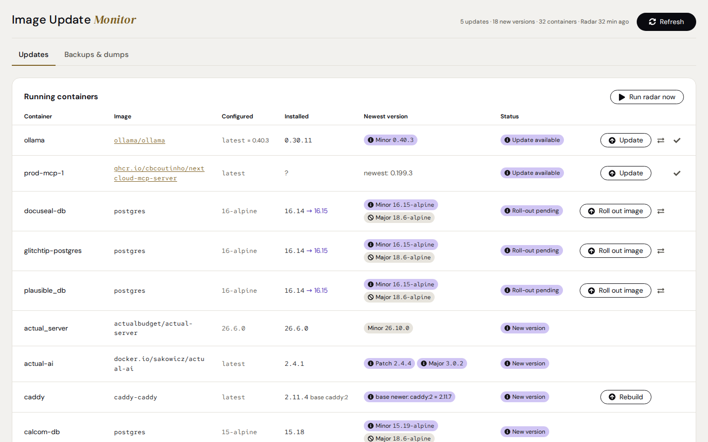
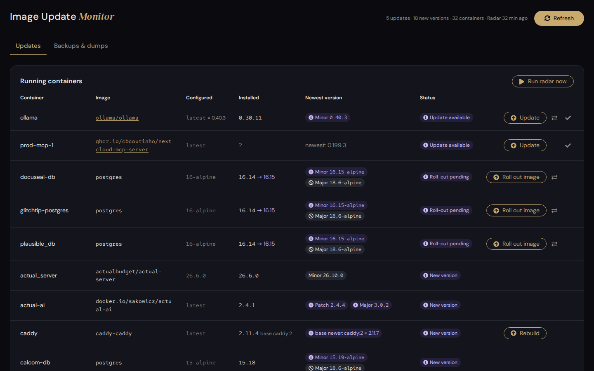
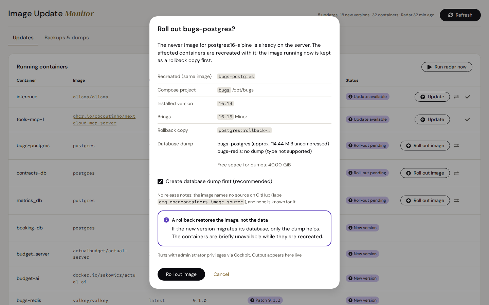
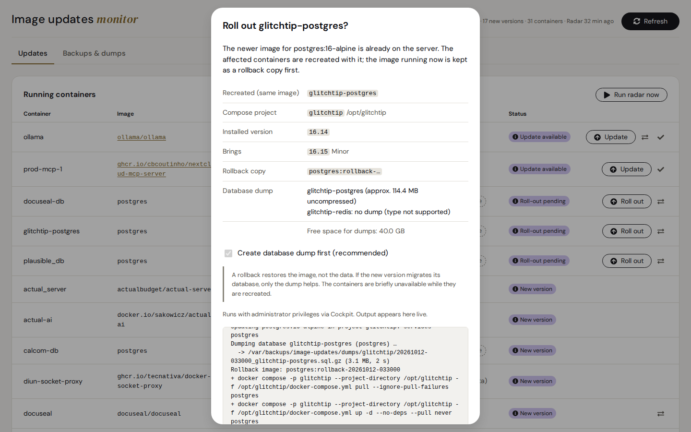
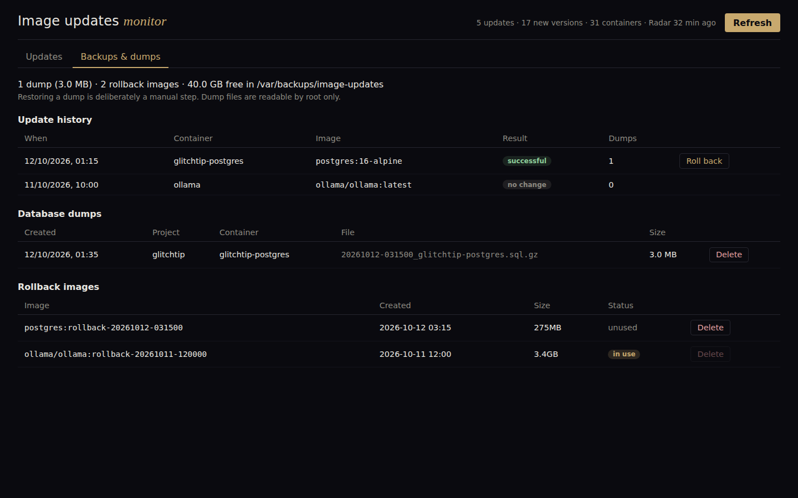
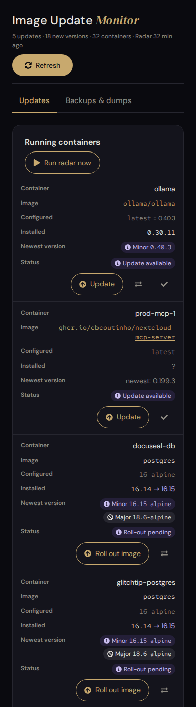
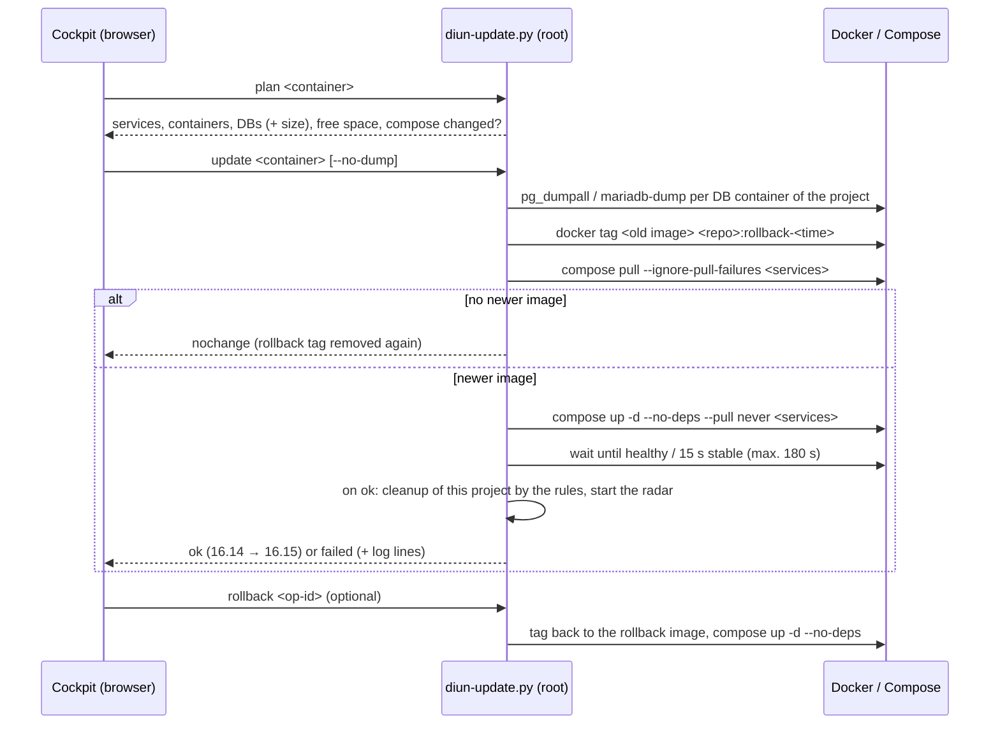

# Image updates monitor for Cockpit

A [Cockpit](https://cockpit-project.org/) add-on that shows three things for every running Docker container: what the compose file says, which version actually runs and which version is the newest.
Updates with the same tag (e.g. `latest`, `16-alpine`) can be applied right from Cockpit, with a database dump first, a rollback copy of the old image and a rollback at the push of a button.
Everything that runs as root for this is a small, fixed set of helper scripts. The browser makes no external requests, and Diun sees Docker only through a read-only socket proxy.

| Light | Dark |
|---|---|
|  |  |

**Contents**

- [What the add-on does](#what-the-add-on-does)
- [Reading the overview](#reading-the-overview)
- [How the installed version is determined](#how-the-installed-version-is-determined)
- [How newer versions are found](#how-newer-versions-are-found)
- [Update and rollback (stage 1)](#update-and-rollback-stage-1)
- [Backups & dumps](#backups--dumps)
- [Architecture](#architecture)
- [Security model](#security-model)
- [Requirements](#requirements)
- [Install, update, uninstall](#install-update-uninstall)
- [Operation and troubleshooting](#operation-and-troubleshooting)
- [Development](#development)
- [Releasing](#releasing)
- [Known limits](#known-limits)
- [Stages](#stages)
- [License](#license)

---

## What the add-on does

| Area | Function |
|---|---|
| **Overview** | All running containers with *Configured* (tag from compose), *Installed* (real version), *Newest version* (patch / minor / major) and status. Sorted by urgency. |
| **Detection** | [Diun](https://crazymax.dev/diun/) reports when the same tag was rebuilt (new digest). The **version radar** looks for newer version tags in the registries every 6 hours, after every update and on “**Run radar now**” in the card. “**Roll-out pending**” finds images that are already pulled but not rolled out yet. |
| **Update / roll out** | One click first shows a plan (affected containers, compose project, databases, free space). Then: database dump → rollback copy → pull → restart of the affected services → wait for “healthy” → result with the versions (“16.14 → 16.15”). If that fails, there is a rollback button. |
| **Backups & dumps** | A tab of its own with the update history (with versions), database dumps and rollback images, each with delete (images in use are locked) and rollback from the history. **Cleanup rules** delete old dumps and unused rollback images after updates and daily; the tab shows what they would delete. |
| **Requirements** | Checks Docker, Diun, skopeo and the radar timer and offers to install missing parts. Existing files are never overwritten. |
| **Use** | The shared Azentrius page frame (header, tabs, signature), light or dark following Cockpit's style, English and German following Cockpit's language (fallback English), loading indicator, rows as blocks on phones, no external resources (strict Cockpit CSP). |

| Update dialog | Result with live output |
|---|---|
|  |  |

| Backups & dumps | On a phone |
|---|---|
|  |  |

---

## Reading the overview

**Columns**

| Column | Meaning |
|---|---|
| Configured | The tag as written in the compose file or with `docker run`, e.g. `latest`, `16-alpine`, `v2.1.4`. |
| Installed | The version that really runs, e.g. `0.30.11`. The tooltip names the source (see below) and the digest. `16.14 → 16.15` means: 16.15 is already on the server but does not run yet. `?` means: cannot be determined, or not covered by the radar yet. |
| Newest version | Newer versions relative to the **installed** version, as patch / minor / major chips. `✓ 6.2.0` = the installed version is the newest. `newest: 6.0.2` appears when the installed version is unknown. |
| Status | see the next table |

**Status**

| Label | Meaning | Button |
|---|---|---|
| ⓘ Update available | Diun reported a new build of **the same tag**. | Update, Dismiss (✓) |
| ⓘ Roll-out pending | The newer image is already local, the container still runs the old one. | Roll out |
| ⓘ New version | The radar knows a newer version. The chip style shows whether the Update button delivers it. | – |
| ✓ Up to date | Nothing newer known. | – |
| ⊘ Unknown | Installed version cannot be determined (e.g. `latest` from a development build). | – |

The labels use the shared status language: a hint in violet with `info-circle`, good in green with
`check-circle`, unknown without judgement with `ban`. Gold is never a status.

Update buttons exist only for containers started with **docker compose** (“manual only” otherwise).

**Chips in “Newest version”**

| Style | Meaning |
|---|---|
| filled | The configured tag delivers this version **with the Update button** (e.g. `latest` → everything, `16-alpine` → 16.x). |
| outlined | Reachable only by **changing the tag in the compose file** (e.g. `v2.1.4` → `v2.1.5`). That is [stage 2](ROADMAP.md#stage-2--version-jumps-change-the-tag-in-the-compose-file). |
| dashed, grey | **Database major** (e.g. Postgres 16 → 18): needs a migration (dump/restore or `pg_upgrade`), not just an image swap. Does not count as “New version”. |
| colour | patch green, minor neutral with bronze (light) or gold (dark) text, major red |

> **Careful with `latest` and similar tags:** they deliver major versions on update too. If Nextcloud `apache` shows a filled red “Major 35.0.1”, a click on *Update* jumps from 34 to 35. Read the release notes before such jumps (Nextcloud allows only one major step at a time).

---

## How the installed version is determined

The tag alone is often not enough: `latest` or `16-alpine` do not say what really runs. The first matching source wins:

| # | Source | Example | Where | Reliability |
|---|---|---|---|---|
| 1 | **Tag** is already an exact version | `v2.1.4` → 2.1.4, `24.3.3.102-alpine` → 24.3.3.102 | inventory (immediately) | certain |
| 2 | **Version variable** of the app in the image | `PG_VERSION=16.14`, `GLITCHTIP_VERSION=6.1.8`, `NEXTCLOUD_VERSION=34.0.3` | inventory (immediately) | certain; must fit the tag (`16-alpine` + `PG_VERSION=17.2` is dropped) |
| 3 | **Image label** `org.opencontainers.image.version` | calcom `v6.2.0`, rustdesk `1.1.15` | radar (every 6 h) | only if this version **exists as a tag** in the registry (ollama inherits “24.04” from its Ubuntu base image → dropped) |
| 4 | **Digest match**: which version tag in the registry points to exactly the installed image? | ollama `latest` → 0.30.11, docuseal → 3.1.6 | radar (every 6 h) | certain when found; the result is stored per image ID |

On source 2: runtime variables such as `NODE_VERSION`, `PYTHON_VERSION` or `PHP_VERSION` do not belong to the app and are ignored. Read are `<IMAGENAME>_VERSION` or `<NAMESPACE>_VERSION`, and `PG_VERSION` for Postgres derivatives (postgres, postgis, pgvector, timescaledb).

On source 4:
- **Docker Hub:** the hub API returns the tag list with digests. This does **not** count against the pull limit. The search goes by recency, at most 10 pages of 100 tags.
- **Other registries (ghcr.io …):** the manifests of the 20 newest version tags are compared (`skopeo inspect --raw`).
- **Storage:** hits are kept for good, misses are retried after 7 days.

What cannot be determined stays `?`. Typical case: `latest` is built on every commit and matches no release.

---

## How newer versions are found

The radar (`diun-versions.py`, systemd timer every 6 h) reads every image's tag list with `skopeo list-tags`. That is not a pull. It compares in the **scheme of the installed version**:

```
scheme = prefix + number of number blocks + suffix
v2.1.4             -> "v"  3 ""
16.14-alpine       -> ""   2 "-alpine"
24.3.3.102-alpine  -> ""   4 "-alpine"
```

- Only tags with an identical scheme count. `-rc1`, `-beta` or `-alpine3.22` are never offered as an update.
- Configured `16-alpine`, installed 16.14: compared with `16.N-alpine` or `N.N-alpine`. Result: minor `16.15-alpine`, major `18.6-alpine`.
- Configured `apache` (Nextcloud), installed 34.0.3: compared with `N.N.N-apache`.
- **Patch / minor / major** follow from the first differing number block. With two-block schemes such as Postgres `16.14` the second block is called “minor”.
- **Reach**: how many number blocks does the configured tag fix? `latest` = 0 → everything reachable. `16-alpine` = 1 → patch and minor reachable. `3.12-slim` = 2 → patch only. `v2.1.4` = 3 → nothing.
- **Database images** (postgres, mariadb, mysql, redis, valkey, clickhouse, mongo …) are marked. Their majors appear as grey info.
- If a registry fails, the last good result stays and is marked “(older data)”.
- **When:** every 6 hours (`diun-radar.timer`), in the background after every successful update or
  rollback, and on **“Run radar now”** in the *Running containers* card. The button stays busy until
  the run is over; systemd never runs the radar twice at once.

---

## Update and rollback (stage 1)

Stage 1 **never** changes the compose file. It fetches the current image of **the same tag** and recreates the containers. Version jumps via a different tag are [stage 2](ROADMAP.md).



**What is included:** all services of the compose project that use **the same image**. With GlitchTip, for example, `web`, `worker` and `migrate`. One-off jobs that end with exit 0 (migrations) count as successful.

**Database dump:** before the update every supported database container **of the project** is backed up:
- **Postgres:** `pg_dumpall` with the superuser `POSTGRES_USER` (default `postgres`, local socket).
- **MariaDB/MySQL:** `mariadb-dump`/`mysqldump --all-databases` with `MARIADB_ROOT_PASSWORD`/`MYSQL_ROOT_PASSWORD` from the container's environment.
- **Whether a container counts as a database:** only if its command really starts the server. Helper containers that merely use the Postgres image (`sh -c …`) are not dumped.
- **When it stops:** if a dump fails or is incomplete (end marker missing), for example because of a wrong password, or there is too little free space. Then the update stops **before any change** (exit 5); dumps of the other databases made in that attempt are removed again.

**Rollback** points the tag back to the rollback copy and recreates the same services.

> **Rollback ≠ data back.** If the new version migrated its database on start, the old program and the new data no longer fit together. Then only the dump helps, and restoring it is deliberately a manual step (see below).

**Locks:** only one update or rollback runs at a time (`/run/lock/diun-update.lock`). A second attempt immediately gets “already running”.

**Not possible from the add-on** (the dialog names the reason in each case):
- containers without docker compose
- images pinned by digest (`@sha256:`)
- locally built images (`build:`)
- missing compose file
- broken compose configuration

---

## Backups & dumps

| What | Where | Rights |
|---|---|---|
| Database dumps | `/var/backups/image-updates/dumps/<project>/<YYYYMMDD-HHMMSS>_<container>.sql.gz` | file 0600, folder 0700 (root only) |
| Update history | `/var/backups/image-updates/operations.jsonl` | 0600 |
| Rollback images | local Docker tags `<repo>:rollback-<YYYYMMDD-HHMMSS>` | – |

- **Delete** in the *Backups & dumps* tab. A rollback image still used by a container cannot be deleted. That is the case, for example, as long as other databases still run on the same old Postgres build.
- **Server backup:** `/var/backups/image-updates` should be part of the backup (e.g. restic), otherwise the dumps live only on the same disk as the database.

**Cleanup rules**

| Rule | Default | Key in `/etc/image-updates.conf` |
|---|---|---|
| Dumps kept per database container (newest first) | 3 | `KEEP_DUMPS` (`0` = never delete dumps) |
| Unused rollback images removed after | 14 days | `ROLLBACK_IMAGE_DAYS` (`0` = never) |

- **Never deleted:** the dumps of each project's last update, rollback images a container (running or stopped) still uses, files in the dump folder that the add-on did not name.
- **When:** after every successful update, for that project's dumps and that image's rollback copies only; daily for everything once `diun-cleanup.timer` is set up (button in the tab, or `diun-deps.sh install cleanup`); on **“Clean up now”** in the tab.
- **Preview:** the tab names the rules and marks every dump and image the next run would delete. On the console: `sudo /usr/local/lib/diun-radar/diun-update.py cleanup --dry-run`.
- **The file** is optional, root-owned and not writable by others, with plain `KEY=VALUE` lines:

  ```bash
  # /etc/image-updates.conf
  KEEP_DUMPS=5
  ROLLBACK_IMAGE_DAYS=30
  ```

  A line that is not understood stops the cleanup with a message instead of guessing.

**Restoring a dump (manually, with care)**

A `pg_dumpall` dump creates roles and databases anew. It belongs in an **empty** Postgres instance. Restored into a running instance with the same databases, it gives “already exists” errors and mixed states. A proven way: stop the app, back up or rename the data volume, start the database container with an empty volume, then:

```bash
# Postgres
zcat /var/backups/image-updates/dumps/<project>/<file>.sql.gz \
  | docker exec -i <db-container> psql -U postgres -d postgres

# MariaDB
zcat /var/backups/image-updates/dumps/<project>/<file>.sql.gz \
  | docker exec -i <db-container> sh -c 'exec mariadb -uroot -p"$MARIADB_ROOT_PASSWORD"'
# MySQL: mysql -uroot -p"$MYSQL_ROOT_PASSWORD"
```

---

## Architecture


| Part | Installed to | Job |
|---|---|---|
| `plugin/` | `/usr/share/cockpit/diun/` | user interface (vanilla JS, no build step), EN/DE |
| `lib/diun-inventory.py` | `/usr/local/lib/diun-radar/` | running containers: tag, version (tag/variable), digest, compose mapping, “pulled, not rolled out” |
| `lib/diun-versions.py` | `/usr/local/lib/diun-radar/` | version radar: installed version (label/digest), newer versions → `versions.json` |
| `lib/diun-update.py` | `/usr/local/lib/diun-radar/` | plan, update with dump, rollback, backup list, delete, cleanup, radar run |
| `lib/diun-deps.sh` | `/usr/local/lib/diun-radar/` | check requirements; install skopeo, Diun stack, radar and cleanup timers |
| `lib/diunlib.py` | `/usr/local/lib/diun-radar/` | shared functions (tag scheme, version variables, reach) |
| `systemd/*` | `/usr/local/lib/diun-radar/systemd/` | unit templates; `diun-deps.sh` copies them to `/etc/systemd/system/` |
| `diun-radar.service/.timer` | `/etc/systemd/system/` | created by `diun-deps.sh install radar`; runs every 6 h (`00/6:17`), hardened (`ProtectSystem=strict` …) |
| `diun-cleanup.service/.timer` | `/etc/systemd/system/` | created by `diun-deps.sh install cleanup`; runs daily (04:40) |
| Diun stack | `/opt/diun/`, data `/var/lib/diun/` | created by `diun-deps.sh install diun`: Diun 4.33.0 + `docker-socket-proxy` (read-only), the script notifier writes JSON lines |

The exact calls, JSON formats and exit codes are in [docs/INTERNALS.md](docs/INTERNALS.md).

---

## Security model

- **Root code in one place only.** Everything Cockpit or systemd runs as root lives in `/usr/local/lib/diun-radar` (root-owned). `/var/lib/diun` is **writable from the Diun container**; nothing is ever run from there.
- **Fixed verbs, checked arguments.** The plugin calls only fixed commands (`plan`, `update`, `rollback`, `backups`, `delete-dump`, `delete-image`, `cleanup`, `radar`, `check`, `install skopeo|diun|radar|cleanup`, `start diun`).
  - Container names, operation IDs, dump paths and rollback tags are checked by regex. Path tricks (`../`) are refused.
  - `delete-image` and the cleanup delete only `…:rollback-YYYYMMDD-HHMMSS` and never an image in use.
  - The cleanup rules come from `/etc/image-updates.conf` only if it belongs to root and nobody else can write it.
- **Cockpit rights.** Reading runs with `superuser: "try"`, actions with `superuser: "require"`. Without administrative access in Cockpit there is a clear message instead of an error.
- **Diun without the Docker socket.** Only the `docker-socket-proxy` sees `/var/run/docker.sock` (read-only). It exposes a filtered, read-only API (`CONTAINERS=1`, `IMAGES=1`, `POST=0`) and publishes no port.
- **Dumps for root only.** Folder 0700, files 0600, written atomically (`.part` → rename). Passwords are read only inside the database container from its environment, never stored or logged.
- **No network from the browser.** No CDNs and no external fonts (the fonts ship with the add-on); Cockpit's strict CSP stays unchanged. Only the radar on the server accesses registries.
- **Concurrency.** `flock` for inventory and update (exit 75 for “already running”). The plugin never starts two loads in parallel.
- **Overwrite nothing.** `diun-deps.sh` stops if target files or a Diun container exist already. `install.sh` backs up the previous version before replacing it.

---

## Requirements

- Linux server with **Cockpit ≥ 266** (systemd)
- **Docker Engine** with **Compose v2** (`docker compose`)
- **Python ≥ 3.8** (standard library only) and `bash`
- For the radar: **skopeo** (the add-on installs it on request with `apt-get` or `dnf`)
- For digest updates: **Diun** (the add-on sets up `/opt/diun` on request)

---

## Install, update, uninstall

**Install / update from a release** (recommended; `X.Y.Z` is the version from the [releases page](https://github.com/Azentrius/cockpit-image-update-monitor/releases))

```bash
curl -LO https://github.com/Azentrius/cockpit-image-update-monitor/releases/download/vX.Y.Z/cockpit-image-update-monitor-X.Y.Z.tar.gz
curl -LO https://github.com/Azentrius/cockpit-image-update-monitor/releases/download/vX.Y.Z/SHA256SUMS
sha256sum --ignore-missing -c SHA256SUMS
tar -xzf cockpit-image-update-monitor-X.Y.Z.tar.gz && cd cockpit-image-update-monitor-X.Y.Z
sudo ./install.sh --dry-run   # only shows what would happen
sudo ./install.sh
```

**Install / update from source**

```bash
git clone https://github.com/Azentrius/cockpit-image-update-monitor.git
cd cockpit-image-update-monitor
sudo ./install.sh --dry-run   # only shows what would happen
sudo ./install.sh
```

`install.sh` copies `plugin/` to `/usr/share/cockpit/diun/`, `lib/` to `/usr/local/lib/diun-radar/` and the unit templates from `systemd/` to `/usr/local/lib/diun-radar/systemd/`, owned by root. It backs up an existing installation to `/usr/local/lib/diun-radar/backup-<timestamp>/` first and starts a radar run if the timer is set up already. Units already in `/etc/systemd/system/` stay untouched; `install.sh` says when one differs from its template.

Then open **“Image updates”** in Cockpit (switch on administrative access). If something is missing, the add-on shows the *Missing requirements* panel right under the tabs, with install buttons. Alternatively on the console:

```bash
sudo /usr/local/lib/diun-radar/diun-deps.sh check
sudo /usr/local/lib/diun-radar/diun-deps.sh install skopeo
sudo /usr/local/lib/diun-radar/diun-deps.sh install diun     # creates /opt/diun and starts the stack
sudo /usr/local/lib/diun-radar/diun-deps.sh install radar    # diun-radar.service + .timer
sudo /usr/local/lib/diun-radar/diun-deps.sh install cleanup  # diun-cleanup.service + .timer (optional)
# dry run without changes: DIUN_DEPS_DRYRUN=1 … install diun
```

**Keep using an existing Diun:** the add-on only needs the event file `/var/lib/diun/events.jsonl`. Add the script notifier `diun-notify.sh` (contained in `lib/diun-deps.sh`) to your own `diun.yml` and mount `/var/lib/diun` as `/data`.

**Uninstall**

```bash
sudo systemctl disable --now diun-radar.timer diun-cleanup.timer
sudo rm -f /etc/systemd/system/diun-radar.service /etc/systemd/system/diun-radar.timer \
           /etc/systemd/system/diun-cleanup.service /etc/systemd/system/diun-cleanup.timer
sudo systemctl daemon-reload
sudo rm -r /usr/share/cockpit/diun
sudo rm -r /usr/local/lib/diun-radar        # also holds the install.sh backups
sudo rm -r /var/lib/diun-radar
# Optional - Diun stack:     cd /opt/diun && sudo docker compose down && sudo rm -r /opt/diun /var/lib/diun
# Deliberately NOT automatic: /var/backups/image-updates (dumps), /etc/image-updates.conf and rollback images
#   docker image ls --format '{{.Repository}}:{{.Tag}}' | grep ':rollback-'
```

---

## Operation and troubleshooting

```bash
# Run the radar now (same as the button) and look at the result
sudo /usr/local/lib/diun-radar/diun-update.py radar
journalctl -u diun-radar.service -n 20
sudo python3 /usr/local/lib/diun-radar/diun-versions.py --table     # table, writes nothing

# What does the plugin see?
sudo /usr/local/lib/diun-radar/diun-inventory.py                    # one JSON line per container
sudo /usr/local/lib/diun-radar/diun-update.py plan <container>      # plan, changes nothing
sudo /usr/local/lib/diun-radar/diun-update.py backups               # dumps, rollback images, history, cleanup preview
sudo /usr/local/lib/diun-radar/diun-update.py cleanup --dry-run     # what the cleanup rules would delete
journalctl -u diun-cleanup.service -n 20                            # last daily cleanup
sudo /usr/local/lib/diun-radar/diun-deps.sh check

# Diun
docker logs diun --tail 50
tail -n 5 /var/lib/diun/events.jsonl
```

| Symptom | Cause / remedy |
|---|---|
| “Container inventory unavailable” | Switch on administrative access in Cockpit, otherwise check Docker. |
| Column *Installed* shows `?` after an update | Label/digest come from the radar, which starts after every update and takes a few minutes. *Run radar now* or `diun-update.py radar` runs it again. |
| “Cleanup rules: … not understood” | Fix the line in `/etc/image-updates.conf` (only `KEEP_DUMPS` and `ROLLBACK_IMAGE_DAYS`, numbers) or make it root-only (`chown root:root`, `chmod 644`). Until then nothing is deleted. |
| “Radar: no data yet” / “(outdated)” | Timer missing or not running: *Missing requirements* panel or `systemctl status diun-radar.timer`. |
| “Registry error”, “(older data)” | Registry unreachable or rate limit; the last good result stays visible. |
| Update stops with “dump … failed” | Nothing was changed. Check the database logs; if need be, untick “Create database dump first” (a deliberate decision). |
| Rollback image cannot be deleted | A container still uses the image; first update all containers on the old build. |

**Exit codes of the helpers:**

| Code | Meaning |
|---|---|
| 0 | ok |
| 1 | a subcommand failed (e.g. the radar run) |
| 2 | not found / not possible (also: cleanup rules not understood) |
| 3 | refused, e.g. already rolled back or file exists |
| 4 | containers do not run stably after update/rollback |
| 5 | stopped before any change (dump, space) |
| 64 | wrong call |
| 75 | already running |
| 77 | no root rights |

---

## Development

```
plugin/            Cockpit package (manifest, index.html, diun.js, diun.css, menu translation) and
                   the shared design files (azentrius.css, azentrius-theme.js, icons.js, fonts)
lib/               root helpers (Python 3 / POSIX sh), installed to /usr/local/lib/diun-radar
systemd/           unit templates (radar, cleanup), installed to /usr/local/lib/diun-radar/systemd
install.sh         installer (DESTDIR, --dry-run, backup of the previous version)
test/              offline tests (Python + jsdom) and the end-to-end test for a real Docker host
tools/preview/     the plugin in a normal browser with test data + screenshots (Playwright)
tools/probe-versions.py   diagnosis: which version sources a host offers (read-only)
tools/check-version.sh    version in diun.js, index.html and CHANGELOG.md agree
tools/release-notes.sh    release notes from CHANGELOG.md
tools/check-units.sh      systemd-analyze verify for the unit templates
tools/check-design-files.sh  the shared design files match tools/design-files.sha256
docs/              INTERNALS.md (interfaces, formats), images
```

**Tests** (no Docker, no root, no network; the `test` workflow runs them on every push and pull request):

```bash
cd test && npm ci && ./run-all.sh
```

**Lint** (the `test` workflow runs it too; the tools are pinned in `test/requirements.txt`):

```bash
pip install -r test/requirements.txt
shellcheck --severity=warning lib/*.sh install.sh test/*.sh tools/*.sh
ruff check .
sh tools/check-units.sh      # unit templates (needs systemd)
```

Covered by the tests, among other things:
- version sources and tag schemes
- Docker Hub and registry matching (with fakes)
- cache and registry outage
- inventory
- `diun-update.py` with fake Docker: database detection, plan reasons, exit codes, update, rollback, cleanup rules, radar
- the page frame: header, tabs (mouse and keyboard), status labels with icons, buttons, signature
- contrast of every colour pair in the light and the dark theme
- the shared design files are identical to the pinned versions (SHA-256)
- loading indicator and repeated loads
- language EN/DE
- requirements panel
- update, rollback, delete and cleanup dialogs, “Run radar now”
- the version columns
- version and changelog agree

**Preview without a server:**

```bash
python3 tools/preview/build.py      # -> tools/preview/out/diun/index.html?lang=en
python3 tools/preview/shoot.py      # screenshots light, dark and phone to docs/img (needs playwright + chromium)
```

**End-to-end on a real host** (creates the throw-away compose projects `imgupd-test` and `imgupd-test-my`, touches nothing else, cleans up afterwards):

```bash
sudo OLD_IMAGE=postgres:16.14-alpine NEW_IMAGE=postgres:16.15-alpine bash test/e2e-server.sh
```

The test checks:
- plan
- update with dump that fails on purpose
- rollback; a second rollback is refused
- update without dump, with versions in the result and the history
- cleanup after the update, limited to the test project
- “nothing newer”
- lock
- backup list with the cleanup preview, `cleanup --dry-run`
- delete, also with a manipulated path
- radar run
- MariaDB (`mariadb:11`) and MySQL (`mysql:8`) dumps with test data; a wrong password stops before any change (`E2E_MYSQL=0` skips this part)

The changes are in [CHANGELOG.md](CHANGELOG.md).

---

## Releasing

Versions follow [Semantic Versioning](https://semver.org/). The version lives in `const VERSION` in `plugin/diun.js`; `plugin/index.html` loads every script and stylesheet of the add-on (the shared design files too) with `?v=<version>`, so browsers fetch the new files after an update.

1. Raise `VERSION` and every `?v=` in `plugin/index.html` (`tools/check-version.sh` finds any it misses), add a section `## X.Y.Z – YYYY-MM-DD` to `CHANGELOG.md`, merge.
2. Actions › release › Run workflow on `main`. The workflow checks the version, runs the tests, packs `cockpit-image-update-monitor-X.Y.Z.tar.gz` with `SHA256SUMS` and creates the tag `vX.Y.Z` with a release whose notes come from `CHANGELOG.md`. It also signs a build provenance for the tarball; for releases after 0.6.1, `gh attestation verify cockpit-image-update-monitor-X.Y.Z.tar.gz --repo Azentrius/cockpit-image-update-monitor` shows that it was built by this workflow from this repository.

---

## Known limits

- **Docker with Compose v2 only.** Podman, Swarm and Kubernetes are not supported. Containers without compose are shown but not updated.
- **Private registries:** the radar runs hardened (`ProtectHome=yes`) and therefore cannot see credentials in `/root/.docker/config.json`. Private images show up as “Registry error”.
- **Version cannot be determined** for `latest` builds without a release behind them (e.g. builds from the main branch).
- **Version jumps** via a different tag and **database majors** are manual (change the compose file).
- **Floating tags with an unknown version** (`latest` without a version label or variable): the update cannot tell how big the jump is and may bring a new major version.
- **Dependencies** (`depends_on`) are not considered: an update recreates only the services that use the image. A database or cache restarts under the running app, which has to reconnect by itself.
- After updates of images whose version can only be determined by label/digest, `?` shows for a few minutes until the radar run started by the update is done.

---

## Stages

In detail, with goals, scope and acceptance criteria, in **[ROADMAP.md](ROADMAP.md)**.

| Stage | Content | State |
|---|---|---|
| 1 | Update/roll out with the same tag, database dump, rollback, backups tab | **done** |
| 1.1 | Polish: start the radar after an update, cleanup rules, “Run radar now”, versions in the history, MariaDB/MySQL E2E, lint in CI | **done** |
| 1.2 | Know before switching: unknown jump size, floating tags resolved, update in two steps, the reason of a failure and the stored output, failed builds remembered, dependencies in the plan | planned |
| 2 | Version jumps: pick a target tag, change the compose file (and `.env`) safely, diff preview, same update flow | planned |
| 3 | Release notes / changelog links per version, hints on breaking changes | idea |
| 4 | Automatic updates by rules (e.g. patch at night), notifications, automatic rollback | idea |
| 5 | Guided database majors (dump → new instance → restore, `pg_upgrade`) | idea |
| 6 | Distribution: Debian package, private registries, Podman, several hosts | idea |

---

## License

[Apache License 2.0](LICENSE).

The add-on contains no code from Cockpit (LGPL-2.1+); it only uses Cockpit's API `cockpit.js` at runtime, which Cockpit itself ships.

Please report security issues privately, see [SECURITY.md](SECURITY.md).
