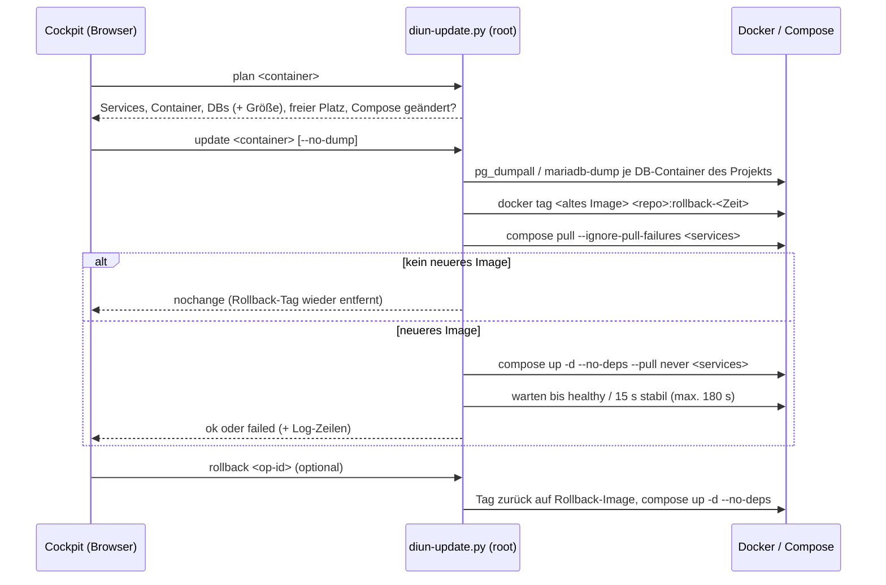
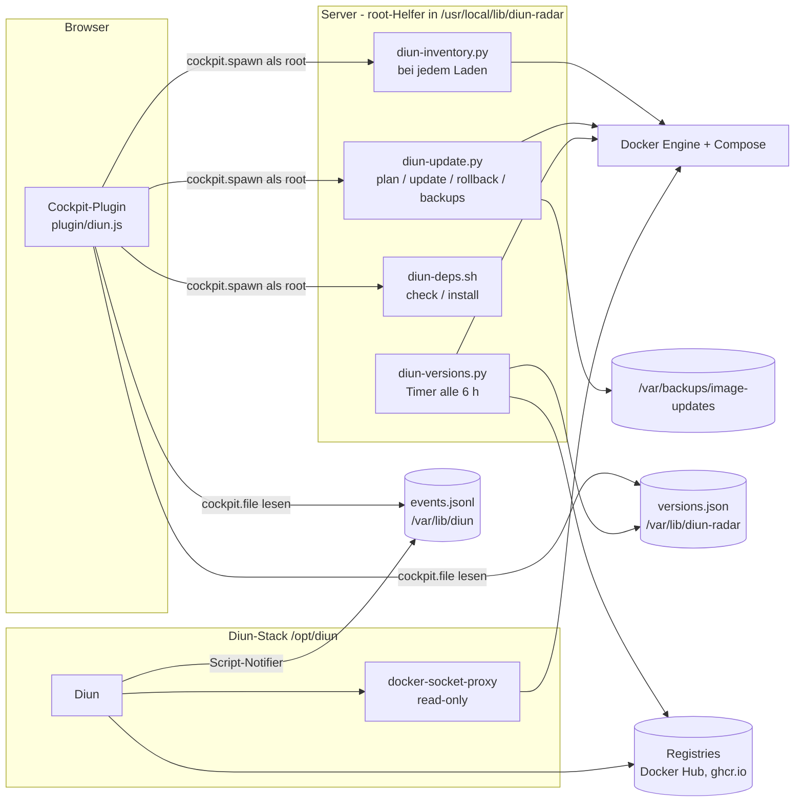

# Image-Updates monitor für Cockpit

Ein [Cockpit](https://cockpit-project.org/)-Addon, das für jeden laufenden Docker-Container drei Dinge zeigt: was in der Compose-Datei steht, welche Version tatsächlich läuft und welche Version die neueste ist.
Updates mit gleichem Tag (z. B. `latest`, `16-alpine`) lassen sich direkt aus Cockpit einspielen, mit Datenbank-Dump vorher, einer Rollback-Kopie des alten Images und einem Rollback auf Knopfdruck.
Alles, was dabei als root läuft, ist ein kleines, festes Set von Hilfsskripten. Der Browser stellt keine externen Anfragen, und Diun sieht Docker nur über einen schreibgeschützten Socket-Proxy.


**Inhalt**

- [Was das Addon kann](#was-das-addon-kann)
- [Die Übersicht lesen](#die-übersicht-lesen)
- [Wie die installierte Version ermittelt wird](#wie-die-installierte-version-ermittelt-wird)
- [Wie neuere Versionen gefunden werden](#wie-neuere-versionen-gefunden-werden)
- [Update und Rollback (Stufe 1)](#update-und-rollback-stufe-1)
- [Backups & Dumps](#backups--dumps)
- [Architektur](#architektur)
- [Sicherheitsmodell](#sicherheitsmodell)
- [Voraussetzungen](#voraussetzungen)
- [Installation, Aktualisierung, Deinstallation](#installation-aktualisierung-deinstallation)
- [Betrieb und Fehlersuche](#betrieb-und-fehlersuche)
- [Entwicklung](#entwicklung)
- [Bekannte Grenzen](#bekannte-grenzen)
- [Ausbaustufen](#ausbaustufen)
- [Lizenz](#lizenz)

---

## Was das Addon kann

| Bereich | Funktion |
|---|---|
| **Übersicht** | Alle laufenden Container mit *Konfiguriert* (Tag aus Compose), *Installiert* (echte Version), *Neueste Version* (Patch / Minor / Major) und Status. Sortiert nach Dringlichkeit. |
| **Erkennung** | [Diun](https://crazymax.dev/diun/) meldet, wenn derselbe Tag neu gebaut wurde (neuer Digest). Der **Versions-Radar** sucht alle 6 Stunden neuere Versions-Tags in den Registries. „**Ausrollen ausstehend**“ erkennt Images, die schon gezogen, aber noch nicht ausgerollt sind. |
| **Update / Ausrollen** | Ein Klick zeigt erst einen Plan (betroffene Container, Compose-Projekt, Datenbanken, freier Platz). Danach: DB-Dump → Rollback-Kopie → Pull → Neustart der betroffenen Services → Warten auf „healthy“ → Ergebnis. Schlägt das fehl, gibt es einen Rollback-Knopf. |
| **Backups & Dumps** | Eigener Tab mit Update-Verlauf, Datenbank-Dumps und Rollback-Images, jeweils mit Löschen (in Benutzung befindliche Images sind gesperrt) und Rollback aus dem Verlauf. |
| **Voraussetzungen** | Prüft Docker, Diun, skopeo und den Radar-Timer und bietet fehlende Teile zur Installation an. Vorhandene Dateien werden nie überschrieben. |
| **Bedienung** | Deutsch und Englisch nach Cockpit-Sprache (Rückfall Englisch), Ladeanzeige, Mobilansicht als Karten, keine externen Ressourcen (strikte Cockpit-CSP). |

| Update-Dialog | Ergebnis mit Live-Ausgabe |
|---|---|
|  |  |


---

## Die Übersicht lesen

**Spalten**

| Spalte | Bedeutung |
|---|---|
| Konfiguriert | Der Tag, wie er in der Compose-Datei bzw. bei `docker run` steht, z. B. `latest`, `16-alpine`, `v2.1.4`. |
| Installiert | Die Version, die wirklich läuft, z. B. `0.30.11`. Der Tooltip nennt die Quelle (siehe unten) und den Digest. `16.14 → 16.15` heißt: 16.15 liegt schon auf dem Server, läuft aber noch nicht. `?` heißt: nicht ermittelbar oder vom Radar noch nicht erfasst. |
| Neueste Version | Neuere Versionen relativ zur **installierten** Version, als Chips Patch / Minor / Major. `✓ 6.2.0` = installiert ist die neueste. `neueste: 6.0.2` erscheint, wenn die installierte Version unbekannt ist. |
| Status | siehe nächste Tabelle |

**Status**

| Badge | Bedeutung | Knopf |
|---|---|---|
| Update verfügbar | Diun hat einen neuen Build **desselben Tags** gemeldet. | Update, Erledigt |
| Ausrollen ausstehend | Das neuere Image ist schon lokal vorhanden, der Container läuft noch auf dem alten. | Ausrollen |
| Neue Version | Der Radar kennt eine neuere Version. Ob der Update-Knopf sie liefert, zeigt die Chip-Form. | – |
| aktuell | Nichts Neueres bekannt. | – |
| unbekannt | Installierte Version nicht ermittelbar (z. B. `latest` aus einem Entwicklungs-Build). | – |

Update-Knöpfe gibt es nur für Container, die mit **docker compose** gestartet wurden („nur manuell“ sonst).

**Chips in „Neueste Version“**

| Form | Bedeutung |
|---|---|
| gefüllt | Der konfigurierte Tag liefert diese Version **per Update-Knopf** (z. B. `latest` → alles, `16-alpine` → 16.x). |
| umrandet | Nur erreichbar, wenn der **Tag in der Compose-Datei geändert** wird (z. B. `v2.1.4` → `v2.1.5`). Das ist [Stufe 2](ROADMAP.md#stufe-2--versionssprünge-tag-in-der-compose-datei-ändern). |
| gestrichelt, grau | **Datenbank-Major** (z. B. Postgres 16 → 18): braucht eine Migration (Dump/Restore oder `pg_upgrade`), kein reiner Image-Tausch. Zählt nicht als „Neue Version“. |
| Farbe | grün = Patch, gold = Minor, rot = Major |

> **Achtung bei `latest` und ähnlichen Tags:** Sie liefern beim Update auch Major-Versionen. Steht bei Nextcloud `apache` ein gefülltes rotes „Major 35.0.1“, springt ein Klick auf *Update* von 34 auf 35. Vor solchen Sprüngen die Release Notes lesen (Nextcloud erlaubt nur einen Major-Schritt auf einmal).

---

## Wie die installierte Version ermittelt wird

Der Tag allein reicht oft nicht: `latest` oder `16-alpine` sagen nicht, was wirklich läuft. Die erste passende Quelle gewinnt:

| # | Quelle | Beispiel | Wo | Verlässlichkeit |
|---|---|---|---|---|
| 1 | **Tag** ist schon eine exakte Version | `v2.1.4` → 2.1.4, `24.3.3.102-alpine` → 24.3.3.102 | Inventar (sofort) | sicher |
| 2 | **Versions-Variable** der App im Image | `PG_VERSION=16.14`, `GLITCHTIP_VERSION=6.1.8`, `NEXTCLOUD_VERSION=34.0.3` | Inventar (sofort) | sicher; muss zum Tag passen (`16-alpine` + `PG_VERSION=17.2` wird verworfen) |
| 3 | **Image-Label** `org.opencontainers.image.version` | calcom `v6.2.0`, rustdesk `1.1.15` | Radar (alle 6 h) | nur wenn es diese Version in der Registry **als Tag gibt** (ollama erbt „24.04“ vom Ubuntu-Basis-Image → verworfen) |
| 4 | **Digest-Abgleich**: Welcher Versions-Tag in der Registry zeigt genau auf das installierte Image? | ollama `latest` → 0.30.11, docuseal → 3.1.6 | Radar (alle 6 h) | sicher, wenn gefunden; Ergebnis wird je Image-ID gespeichert |

Zu Quelle 2: Laufzeit-Variablen wie `NODE_VERSION`, `PYTHON_VERSION` oder `PHP_VERSION` gehören nicht zur App und werden ignoriert. Gelesen wird `<IMAGENAME>_VERSION` bzw. `<NAMESPACE>_VERSION`, für Postgres-Abkömmlinge (postgres, postgis, pgvector, timescaledb) `PG_VERSION`.

Zu Quelle 4:
- **Docker Hub:** Die Hub-API liefert die Tag-Liste mit Digests. Das zählt **nicht** gegen das Pull-Limit. Gesucht wird nach Aktualität, maximal 10 Seiten à 100 Tags.
- **Andere Registries (ghcr.io …):** Verglichen werden die Manifeste der 20 neuesten Versions-Tags (`skopeo inspect --raw`).
- **Speicherung:** Treffer bleiben dauerhaft gespeichert, Fehlschläge werden nach 7 Tagen erneut versucht.

Was nicht ermittelbar ist, bleibt `?`. Typischer Fall: `latest` wird bei jedem Commit gebaut und entspricht keinem Release.

---

## Wie neuere Versionen gefunden werden

Der Radar (`diun-versions.py`, systemd-Timer alle 6 h) liest die Tag-Liste jedes Images mit `skopeo list-tags`. Das ist kein Pull. Verglichen wird im **Schema der installierten Version**:

```
Schema = Präfix + Anzahl Zahlenblöcke + Suffix
v2.1.4             -> "v"  3 ""
16.14-alpine       -> ""   2 "-alpine"
24.3.3.102-alpine  -> ""   4 "-alpine"
```

- Nur Tags mit identischem Schema zählen. `-rc1`, `-beta` oder `-alpine3.22` werden nie als Update angeboten.
- Konfiguriert `16-alpine`, installiert 16.14: verglichen wird mit `16.N-alpine` bzw. `N.N-alpine`. Ergebnis: Minor `16.15-alpine`, Major `18.6-alpine`.
- Konfiguriert `apache` (Nextcloud), installiert 34.0.3: verglichen wird mit `N.N.N-apache`.
- **Patch / Minor / Major** ergeben sich aus dem ersten abweichenden Zahlenblock. Bei zweistelligen Schemata wie Postgres `16.14` heißt der zweite Block „Minor“.
- **Erreichbarkeit** („reach“): Wie viele Zahlenblöcke legt der konfigurierte Tag fest? `latest` = 0 → alles erreichbar. `16-alpine` = 1 → Patch und Minor erreichbar. `3.12-slim` = 2 → nur Patch. `v2.1.4` = 3 → nichts.
- **Datenbank-Images** (postgres, mariadb, mysql, redis, valkey, clickhouse, mongo …) sind markiert. Ihre Majors erscheinen als graue Info.
- Fällt eine Registry aus, bleibt das letzte gute Ergebnis stehen und ist als „(Stand älter)“ markiert.

---

## Update und Rollback (Stufe 1)

Stufe 1 ändert **nie** die Compose-Datei. Sie holt das aktuelle Image **desselben Tags** und erstellt die Container neu. Versionssprünge über einen anderen Tag sind [Stufe 2](ROADMAP.md).



**Was mitgenommen wird:** alle Services des Compose-Projekts, die **dasselbe Image** nutzen. Bei GlitchTip zum Beispiel `web`, `worker` und `migrate`. Einmal-Jobs, die mit Exit 0 enden (Migrationen), gelten als erfolgreich.

**Datenbank-Dump:** Vor dem Update wird jeder unterstützte Datenbank-Container **des Projekts** gesichert:
- **Postgres:** `pg_dumpall` mit dem Superuser `POSTGRES_USER` (Standard `postgres`, lokaler Socket).
- **MariaDB/MySQL:** `mariadb-dump`/`mysqldump --all-databases` mit `MARIADB_ROOT_PASSWORD`/`MYSQL_ROOT_PASSWORD` aus der Umgebung des Containers.
- **Ob ein Container als Datenbank zählt:** nur wenn sein Befehl wirklich den Server startet. Hilfscontainer, die das Postgres-Image nur nutzen (`sh -c …`), werden nicht gedumpt.
- **Wann abgebrochen wird:** wenn ein Dump fehlschlägt oder unvollständig ist (Endmarke fehlt) oder zu wenig Platz frei ist. Dann bricht das Update **vor jeder Änderung** ab (Exit 5).

**Rollback** setzt den Tag auf die Rollback-Kopie zurück und erstellt dieselben Services neu.

> **Rollback ≠ Daten zurück.** Hat die neue Version beim Start ihre Datenbank migriert, passen altes Programm und neue Daten nicht mehr zusammen. Dann hilft nur der Dump, und das Einspielen ist bewusst ein manueller Schritt (siehe unten).

**Sperren:** Es läuft immer nur ein Update oder Rollback gleichzeitig (`/run/lock/diun-update.lock`). Ein zweiter Versuch bekommt sofort „läuft bereits“.

**Nicht über das Addon möglich** (der Dialog nennt jeweils den Grund):
- Container ohne docker compose
- per Digest gepinnte Images (`@sha256:`)
- lokal gebaute Images (`build:`)
- fehlende Compose-Datei
- fehlerhafte Compose-Konfiguration

---

## Backups & Dumps

| Was | Wo | Rechte |
|---|---|---|
| Datenbank-Dumps | `/var/backups/image-updates/dumps/<projekt>/<JJJJMMTT-HHMMSS>_<container>.sql.gz` | Datei 0600, Ordner 0700 (nur root) |
| Update-Verlauf | `/var/backups/image-updates/operations.jsonl` | 0600 |
| Rollback-Images | lokale Docker-Tags `<repo>:rollback-<JJJJMMTT-HHMMSS>` | – |

- **Löschen** geht im Tab *Backups & Dumps*. Ein Rollback-Image, das noch ein Container nutzt, lässt sich nicht löschen. Das ist z. B. so, solange andere Datenbanken noch auf demselben alten Postgres-Build laufen.
- **Aufräumen** passiert derzeit **nicht automatisch**, siehe [Ausbaustufen](ROADMAP.md).
- **Server-Backup:** `/var/backups/image-updates` sollte im Backup enthalten sein (z. B. restic), sonst liegen die Dumps nur auf derselben Platte wie die Datenbank.

**Dump einspielen (manuell, mit Bedacht)**

Ein `pg_dumpall`-Dump legt Rollen und Datenbanken neu an. Er gehört in eine **leere** Postgres-Instanz. In eine laufende Instanz mit denselben Datenbanken eingespielt, gibt es „already exists“-Fehler und gemischte Stände. Bewährter Weg: App stoppen, Daten-Volume sichern bzw. umbenennen, Datenbank-Container mit leerem Volume starten, dann:

```bash
# Postgres
zcat /var/backups/image-updates/dumps/<projekt>/<datei>.sql.gz \
  | docker exec -i <db-container> psql -U postgres -d postgres

# MariaDB
zcat /var/backups/image-updates/dumps/<projekt>/<datei>.sql.gz \
  | docker exec -i <db-container> sh -c 'exec mariadb -uroot -p"$MARIADB_ROOT_PASSWORD"'
# MySQL: mysql -uroot -p"$MYSQL_ROOT_PASSWORD"
```

---

## Architektur



| Teil | Installiert nach | Aufgabe |
|---|---|---|
| `plugin/` | `/usr/share/cockpit/diun/` | Oberfläche (Vanilla-JS, kein Build-Schritt), DE/EN |
| `lib/diun-inventory.py` | `/usr/local/lib/diun-radar/` | Laufende Container: Tag, Version (Tag/Variable), Digest, Compose-Zuordnung, „gezogen, nicht ausgerollt“ |
| `lib/diun-versions.py` | `/usr/local/lib/diun-radar/` | Versions-Radar: installierte Version (Label/Digest), neuere Versionen → `versions.json` |
| `lib/diun-update.py` | `/usr/local/lib/diun-radar/` | Plan, Update mit Dump, Rollback, Backup-Liste, Löschen |
| `lib/diun-deps.sh` | `/usr/local/lib/diun-radar/` | Voraussetzungen prüfen; skopeo, Diun-Stack, Radar-Timer installieren |
| `lib/diunlib.py` | `/usr/local/lib/diun-radar/` | gemeinsame Funktionen (Tag-Schema, Versions-Variablen, Erreichbarkeit) |
| `diun-radar.service/.timer` | `/etc/systemd/system/` | angelegt von `diun-deps.sh install radar`; Lauf alle 6 h (`00/6:17`), gehärtet (`ProtectSystem=strict` …) |
| Diun-Stack | `/opt/diun/`, Daten `/var/lib/diun/` | angelegt von `diun-deps.sh install diun`: Diun 4.33.0 + `docker-socket-proxy` (nur lesend), Script-Notifier schreibt JSON-Zeilen |

Die genauen Aufrufe, JSON-Formate und Exit-Codes stehen in [docs/INTERNALS.md](docs/INTERNALS.md).

---

## Sicherheitsmodell

- **Root-Code nur an einer Stelle.** Alles, was Cockpit oder systemd als root ausführt, liegt in `/usr/local/lib/diun-radar` (root-owned). `/var/lib/diun` ist **im Diun-Container beschreibbar**, von dort wird nie etwas ausgeführt.
- **Feste Verben, geprüfte Argumente.** Das Plugin ruft nur festgelegte Befehle auf (`plan`, `update`, `rollback`, `backups`, `delete-dump`, `delete-image`, `check`, `install skopeo|diun|radar`, `start diun`).
  - Container-Namen, Vorgangs-IDs, Dump-Pfade und Rollback-Tags werden per Regex geprüft. Pfad-Tricks (`../`) werden abgelehnt.
  - `delete-image` löscht nur `…:rollback-JJJJMMTT-HHMMSS` und nie ein Image, das in Benutzung ist.
- **Cockpit-Rechte.** Lesen läuft mit `superuser: "try"`, Aktionen mit `superuser: "require"`. Ohne administrativen Zugriff in Cockpit gibt es eine klare Meldung statt eines Fehlers.
- **Diun ohne Docker-Socket.** Nur der `docker-socket-proxy` sieht `/var/run/docker.sock` (read-only). Er gibt eine gefilterte, nur lesende API frei (`CONTAINERS=1`, `IMAGES=1`, `POST=0`) und veröffentlicht keinen Port.
- **Dumps nur für root.** Ordner 0700, Dateien 0600, atomar geschrieben (`.part` → Umbenennen). Passwörter werden nur im Datenbank-Container aus dessen Umgebung gelesen, nie gespeichert oder geloggt.
- **Kein Netz aus dem Browser.** Keine CDNs, keine Webfonts; Cockpits strikte CSP bleibt unverändert. Registry-Zugriffe macht nur der Radar auf dem Server.
- **Nebenläufigkeit.** `flock` für Inventar und Update (Exit 75 bei „läuft schon“). Das Plugin startet nie zwei Ladevorgänge parallel.
- **Nichts überschreiben.** `diun-deps.sh` bricht ab, wenn Ziel-Dateien oder ein Diun-Container schon existieren. `install.sh` sichert die vorige Version, bevor es ersetzt.

---

## Voraussetzungen

- Linux-Server mit **Cockpit ≥ 266** (systemd)
- **Docker Engine** mit **Compose v2** (`docker compose`)
- **Python ≥ 3.8** (nur Standardbibliothek) und `bash`
- Für den Radar: **skopeo** (das Addon installiert es auf Wunsch per `apt-get` oder `dnf`)
- Für Digest-Updates: **Diun** (das Addon richtet `/opt/diun` auf Wunsch ein)

---

## Installation, Aktualisierung, Deinstallation

**Installieren / aktualisieren**

```bash
git clone https://github.com/Azentrius/cockpit-image-update-monitor.git
cd cockpit-image-update-monitor
sudo ./install.sh --dry-run   # zeigt nur, was passieren würde
sudo ./install.sh
```

`install.sh` kopiert `plugin/` nach `/usr/share/cockpit/diun/` und `lib/` nach `/usr/local/lib/diun-radar/` mit Besitzer root. Es sichert eine vorhandene Installation vorher nach `/usr/local/lib/diun-radar/backup-<Zeitstempel>/` und stößt einen Radar-Lauf an, falls der Timer schon eingerichtet ist.

Danach in Cockpit **„Image-Updates“** öffnen (administrativen Zugriff einschalten). Fehlt etwas, zeigt das Addon oben das Panel *Voraussetzungen unvollständig* mit Installieren-Knöpfen. Alternativ auf der Konsole:

```bash
sudo /usr/local/lib/diun-radar/diun-deps.sh check
sudo /usr/local/lib/diun-radar/diun-deps.sh install skopeo
sudo /usr/local/lib/diun-radar/diun-deps.sh install diun     # legt /opt/diun an und startet den Stack
sudo /usr/local/lib/diun-radar/diun-deps.sh install radar    # diun-radar.service + .timer
# Probelauf ohne Änderungen: DIUN_DEPS_DRYRUN=1 … install diun
```

**Vorhandenes Diun weiterverwenden:** Das Addon braucht nur die Ereignis-Datei `/var/lib/diun/events.jsonl`. Den Script-Notifier `diun-notify.sh` (in `lib/diun-deps.sh` enthalten) in die eigene `diun.yml` eintragen und `/var/lib/diun` als `/data` mounten.

**Deinstallieren**

```bash
sudo systemctl disable --now diun-radar.timer
sudo rm /etc/systemd/system/diun-radar.service /etc/systemd/system/diun-radar.timer
sudo systemctl daemon-reload
sudo rm -r /usr/share/cockpit/diun
sudo rm -r /usr/local/lib/diun-radar        # enthält auch die install.sh-Sicherungen
sudo rm -r /var/lib/diun-radar
# Optional - Diun-Stack:     cd /opt/diun && sudo docker compose down && sudo rm -r /opt/diun /var/lib/diun
# Bewusst NICHT automatisch: /var/backups/image-updates (Dumps) und Rollback-Images
#   docker image ls --format '{{.Repository}}:{{.Tag}}' | grep ':rollback-'
```

---

## Betrieb und Fehlersuche

```bash
# Radar sofort laufen lassen und Ergebnis ansehen
sudo systemctl start diun-radar.service
journalctl -u diun-radar.service -n 20
sudo python3 /usr/local/lib/diun-radar/diun-versions.py --table     # Tabelle, schreibt nichts

# Was sieht das Plugin?
sudo /usr/local/lib/diun-radar/diun-inventory.py                    # eine JSON-Zeile je Container
sudo /usr/local/lib/diun-radar/diun-update.py plan <container>      # Plan, ändert nichts
sudo /usr/local/lib/diun-radar/diun-update.py backups               # Dumps, Rollback-Images, Verlauf
sudo /usr/local/lib/diun-radar/diun-deps.sh check

# Diun
docker logs diun --tail 50
tail -n 5 /var/lib/diun/events.jsonl
```

| Symptom | Ursache / Abhilfe |
|---|---|
| „Container-Inventar nicht verfügbar“ | Administrativen Zugriff in Cockpit einschalten, sonst Docker prüfen. |
| Spalte *Installiert* zeigt `?` nach einem Update | Label/Digest kommen vom Radar (alle 6 h). `systemctl start diun-radar.service` aktualisiert sofort. |
| „Radar: noch keine Daten“ / „(veraltet)“ | Timer fehlt oder läuft nicht: Panel *Voraussetzungen* oder `systemctl status diun-radar.timer`. |
| „Registry-Fehler“, „(Stand älter)“ | Registry nicht erreichbar oder Rate-Limit; das letzte gute Ergebnis wird weiter angezeigt. |
| Update bricht mit „Dump … fehlgeschlagen“ ab | Nichts wurde geändert. Datenbank-Logs prüfen; zur Not „Vorher Datenbank-Dump erstellen“ abwählen (bewusste Entscheidung). |
| Rollback-Image lässt sich nicht löschen | Ein Container nutzt das Image noch; erst alle Container auf dem alten Build aktualisieren. |

**Exit-Codes der Helfer:**

| Code | Bedeutung |
|---|---|
| 0 | ok |
| 2 | nicht gefunden / nicht möglich |
| 3 | abgelehnt, z. B. schon zurückgerollt oder Datei existiert |
| 4 | Container laufen nach Update/Rollback nicht stabil |
| 5 | vor jeder Änderung abgebrochen (Dump, Platz) |
| 64 | falscher Aufruf |
| 75 | läuft schon |
| 77 | keine root-Rechte |

---

## Entwicklung

```
plugin/            Cockpit-Paket (manifest, index.html, diun.js, diun.css, Menü-Übersetzung)
lib/               root-Helfer (Python 3 / POSIX sh), werden nach /usr/local/lib/diun-radar installiert
install.sh         Installer (DESTDIR, --dry-run, Sicherung der Vorversion)
test/              Offline-Tests (Python + jsdom) und der End-to-End-Test für einen echten Docker-Host
tools/preview/     Plugin im normalen Browser mit Testdaten + Screenshots (Playwright)
tools/probe-versions.py   Diagnose: welche Versions-Quellen ein Host hergibt (nur lesend)
docs/              INTERNALS.md (Schnittstellen, Formate), Bilder
```

**Tests** (kein Docker, kein root, kein Netz):

```bash
cd test && npm ci && ./run-all.sh
```

Abgedeckt sind unter anderem:
- Versionsquellen und Tag-Schemata
- Docker-Hub- und Registry-Abgleich (mit Fakes)
- Cache und Registry-Ausfall
- Inventar
- Ladeanzeige und Mehrfach-Laden
- Sprache DE/EN
- Voraussetzungs-Panel
- Update-, Rollback- und Lösch-Dialoge
- die Versions-Spalten

**Vorschau ohne Server:**

```bash
python3 tools/preview/build.py      # -> tools/preview/out/diun/index.html?lang=de
python3 tools/preview/shoot.py      # Screenshots nach docs/img (braucht playwright + chromium)
```

**End-to-End auf einem echten Host** (legt ein Wegwerf-Compose-Projekt `imgupd-test` an, fasst sonst nichts an, räumt danach auf):

```bash
sudo OLD_IMAGE=postgres:16.14-alpine NEW_IMAGE=postgres:16.15-alpine bash test/e2e-server.sh
```

Der Test prüft:
- Plan
- Update mit Dump, das absichtlich scheitert
- Rollback, doppelter Rollback wird abgelehnt
- Update ohne Dump
- „nichts Neueres“
- Sperre
- Backup-Liste
- Löschen, auch mit manipuliertem Pfad

Hinweise für die Weiterarbeit mit Claude Code stehen in [CLAUDE.md](CLAUDE.md), die Änderungen in [CHANGELOG.md](CHANGELOG.md).

---

## Bekannte Grenzen

- **Nur Docker mit Compose v2.** Podman, Swarm und Kubernetes werden nicht unterstützt. Container ohne Compose werden angezeigt, aber nicht aktualisiert.
- **Private Registries:** Der Radar läuft gehärtet (`ProtectHome=yes`) und sieht daher keine Zugangsdaten in `/root/.docker/config.json`. Private Images erscheinen als „Registry-Fehler“.
- **Version nicht ermittelbar** bei `latest`-Builds ohne Release-Bezug (z. B. Builds aus dem Hauptzweig).
- **MariaDB/MySQL-Dump** ist implementiert, aber bisher nur gegen Postgres Ende-zu-Ende getestet.
- **Kein automatisches Aufräumen** alter Dumps und Rollback-Images.
- **Versionssprünge** über einen anderen Tag und **Datenbank-Majors** sind manuell (Compose-Datei ändern).
- Nach Updates von Images, deren Version nur per Label/Digest bestimmbar ist, steht bis zum nächsten Radar-Lauf `?`.

---

## Ausbaustufen

Ausführlich mit Zielen, Umfang und Abnahmekriterien in **[ROADMAP.md](ROADMAP.md)**.

| Stufe | Inhalt | Stand |
|---|---|---|
| 1 | Update/Ausrollen mit gleichem Tag, DB-Dump, Rollback, Backups-Tab | **fertig** |
| 1.1 | Feinschliff: Radar nach Update anstoßen, Aufräumregeln, „Radar jetzt prüfen“, Versionen im Verlauf, MariaDB-E2E, CI | geplant |
| 2 | Versionssprünge: Ziel-Tag wählen, Compose-Datei (und `.env`) sicher ändern, Diff-Vorschau, gleicher Update-Ablauf | geplant |
| 3 | Release Notes / Changelog-Links je Version, Hinweise auf Breaking Changes | Idee |
| 4 | Automatische Updates nach Regeln (z. B. Patch nachts), Benachrichtigungen, Auto-Rollback | Idee |
| 5 | Datenbank-Majors begleitet (Dump → neue Instanz → Restore, `pg_upgrade`) | Idee |
| 6 | Verteilung: Debian-Paket, private Registries, Podman, mehrere Hosts | Idee |

---

## Lizenz

[Apache License 2.0](LICENSE).

Das Addon enthält keinen Code aus Cockpit (LGPL-2.1+); es nutzt nur zur Laufzeit dessen API `cockpit.js`, die Cockpit selbst ausliefert.

Sicherheitslücken bitte vertraulich melden, siehe [SECURITY.md](SECURITY.md).
