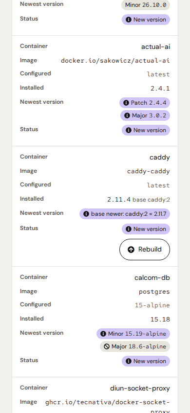
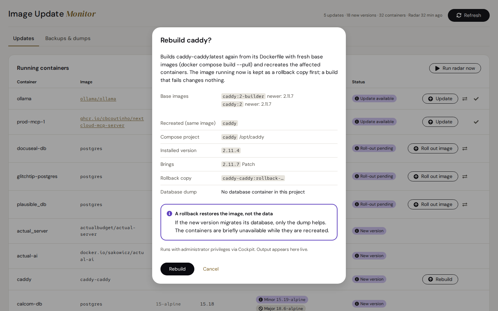
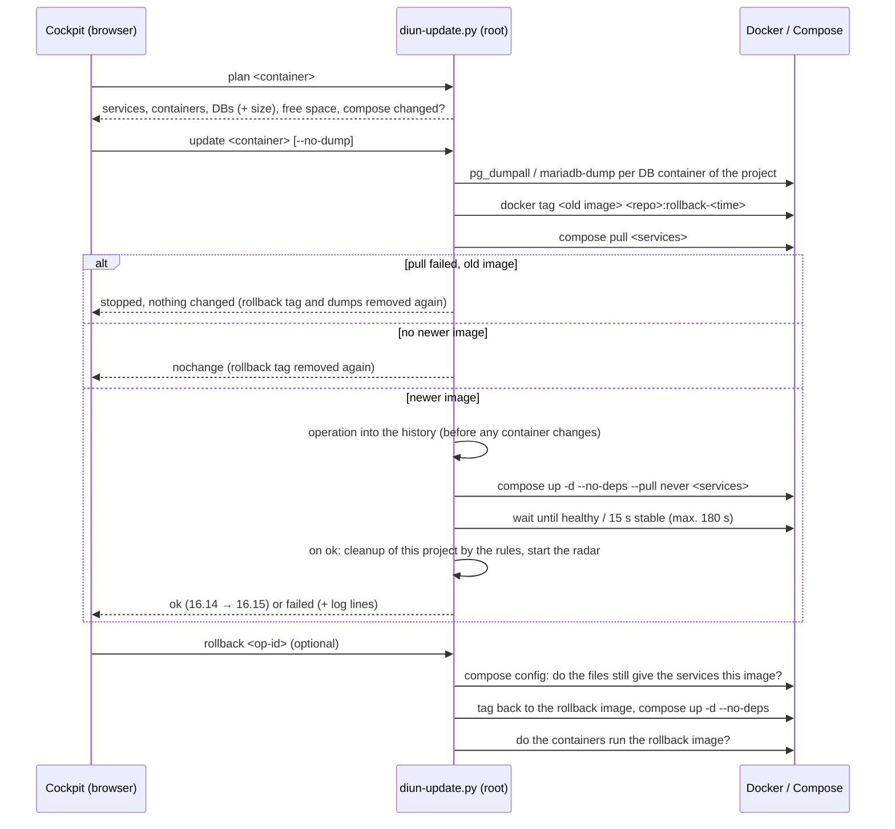
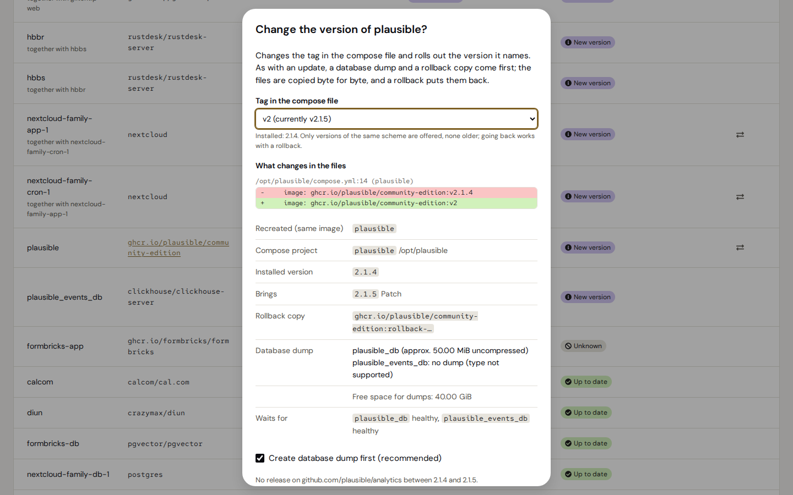
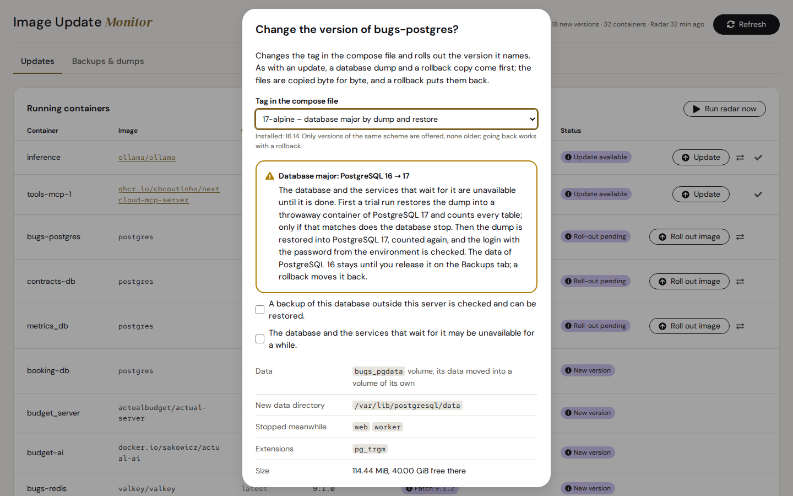
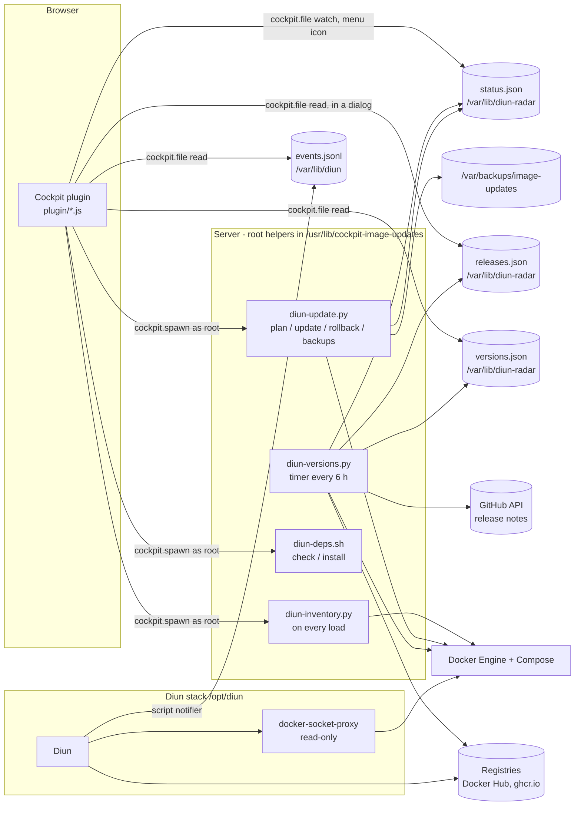

# Image Update Monitor

A [Cockpit](https://cockpit-project.org/) add-on that shows three things for every running Docker container: what the compose file says, which version actually runs and which version is the newest.
Updates with the same tag (e.g. `latest`, `16-alpine`) can be applied right from Cockpit, with a database dump first, a rollback copy of the old image and a rollback at the push of a button.
A different version (another tag in the compose file) is chosen from a list; the add-on shows the lines it will change, keeps byte-exact copies of the files and puts them back on rollback.
A newer PostgreSQL or MariaDB major runs by dump and restore after a trial run in a throwaway container, and images built on the server are built again once a base image is newer.
Everything that runs as root for this is a small, fixed set of helper scripts. The browser makes no external requests, and Diun sees Docker only through a read-only socket proxy.

| Light | Dark |
|---|---|
|  |  |

**Contents**

- [What the add-on does](#what-the-add-on-does)
- [Reading the overview](#reading-the-overview)
- [How the installed version is determined](#how-the-installed-version-is-determined)
- [How newer versions are found](#how-newer-versions-are-found)
- [Update and rollback (stage 1)](#update-and-rollback-stage-1)
- [Change version (stage 2)](#change-version-stage-2)
- [Release notes (stage 3)](#release-notes-stage-3)
- [Database majors (stage 5)](#database-majors-stage-5)
- [Backups & dumps](#backups--dumps)
- [Architecture](#architecture)
- [Security model](#security-model)
- [Requirements](#requirements)
- [Install, update, uninstall](#install-update-uninstall)
- [Operation and troubleshooting](#operation-and-troubleshooting)
- [Development](#development)
- [Releasing](#releasing)
- [Known limits](#known-limits)
- [Stages](#stages)
- [License](#license)

---

## What the add-on does

| Area | Function |
|---|---|
| **Overview** | All running containers with *Configured* (tag from compose), *Installed* (real version), *Newest version* (patch / minor / major) and status. Sorted by urgency. |
| **Detection** | [Diun](https://crazymax.dev/diun/) reports when the same tag was rebuilt (new digest). The **version radar** looks for newer version tags in the registries every 6 hours, after every update and on “**Run radar now**” in the card. “**Roll-out pending**” finds images that are already pulled but not rolled out yet. |
| **Update / roll out** | One click first shows a plan (containers recreated with it, one-off jobs, compose project, databases, what the services wait for and what waits for them, free space). Then: database dump → rollback copy → pull → restart of the affected services → wait for “healthy” → result with the versions (“16.14 → 16.15”). If nobody can tell how big the jump is (unknown version, tag `latest`), the plan says so and asks for an extra confirmation. If the containers do not come up, the most likely cause from their log stands next to the rollback button. **In two steps** if you like: download now, roll out later (e.g. in a maintenance window). The plan lists the **release notes** from GitHub between the installed and the new version, with *breaking*, *migration* and *deprecated* marked. Images **built on the server** (`build:`) get **Rebuild** once a base image is newer: the same flow with `docker compose build --pull` instead of the pull. |
| **Change version** | A list of the versions the registry offers for the installed one: pin the running version, a version line such as `5`, an exact patch / minor / major version, or `latest`. The dialog shows every line of the compose file (or `.env`) before and after, then the same plan and flow as an update; the rollback puts the files back byte for byte. A newer PostgreSQL or MariaDB major runs as a **database major** (below); other database majors (MySQL, Redis …) and Nextcloud jumps over more than one major are listed but locked. |
| **Database majors** | PostgreSQL 16 → 17 and MariaDB 11 → 12 (or another newer major) by dump and restore, from *Change version*, after a trial run in a throwaway container: the services that wait for the database stop, every table is counted before and after, the old data is moved aside (not copied) and kept until you release it, a rollback moves it back. Two tick boxes first: a backup checked elsewhere, the downtime. |
| **Backups & dumps** | A tab of its own with the update history (with versions), database dumps and rollback images, each with delete (images in use are locked) and rollback from the history. **Cleanup rules** delete old dumps and unused rollback images after updates and daily; the tab shows what they would delete. |
| **Requirements** | Checks Docker, Diun, skopeo and the radar timer and offers to install missing parts. Existing files are never overwritten. |
| **Status Board** | `diun-update.py status --lang en\|de` gives the shared status of the Azentrius add-ons, which the Status Board on a Cockpit bastion shows as a tile per host: updates available, failed updates, an outdated radar, roll-outs pending and new versions, the same rows the overview marks. It works without administrative access on the host: the radar run and every update, rollback and cleanup write it to `/var/lib/diun-radar/status.json`, readable by all, with the names of containers only. A click on the tile opens the page where the finding is: the Updates tab at the first row of that kind, or the update history. |
| **Status in the menu** | Cockpit's menu shows the same state next to “Image Update Monitor”, with Cockpit's own icons (blue: something to do, yellow: the radar is outdated or reached no registry, red: an update failed) and the summary as the tooltip, e.g. “2 updates available, 3 roll-outs pending”. Nothing to do, no icon. For this Cockpit loads the page hidden after the login; until you open it, it only reads `status.json` and runs no helper. |
| **Use** | The shared Azentrius page frame (header, tabs, signature), light or dark following Cockpit's style, English and German following Cockpit's language (fallback English), loading indicator, rows as blocks on phones, no external resources (strict Cockpit CSP). |

| Update dialog | Result with live output |
|---|---|
|  |  |

| Backups & dumps | On a phone |
|---|---|
|  |  |

---

## Reading the overview

**Columns**

| Column | Meaning |
|---|---|
| Configured | The tag as written in the compose file or with `docker run`, e.g. `latest`, `16-alpine`, `v2.1.4`. For tags without a full version it adds what the tag points to in the registry right now: `latest = 6.0.2`. |
| Installed | The version that really runs, e.g. `0.30.11`. The tooltip names the source (see below) and the digest. `16.14 → 16.15` means: 16.15 is already on the server but does not run yet. `?` means: cannot be determined, or not covered by the radar yet. `main @35b2a97`: a development build without a version that names the commit it was built from. `2.11.4 base caddy:2`: an image built on this server names no version of its own; the version its final base image brings stands in. |
| Newest version | Newer versions relative to the **installed** version, one label per level (patch / minor / major, the level as a word). A check mark (`check-circle`) with `6.2.0` = the installed version is the newest. `newest: 6.0.2` appears when the installed version is unknown. `build after v4.5.3`: a tag like `latest` points to no release tag but to a build Docker Hub got at least a day after the newest release, often a development build (MobSF does this); with a check mark when the container runs exactly that build. `newest build from 28 Oct 2025` / `other build`: the registry has no release tag at all (an own image built from its main branch, or an abandoned one), and the container runs the build a tag like `latest` points to now, or another one; the date is when that build was made, so an old image stays visible. `nothing new for over a year` (below the check mark): the container runs the newest there is, but that image was built over a year ago; the project may be abandoned, and fixes in its base image do not reach it. `base newer: caddy:2 = 2.11.7` / `base current`: the image is built on this server (compose `build:`), and the radar checks the images its Dockerfile starts from; with a newer base the row offers **Rebuild** (see [Update and rollback](#update-and-rollback-stage-1)), and the tooltip says how to do it by hand. `not in a registry`: no registry shows the image, because it was built or tagged on the server or is private; there is nothing newer to find. |
| Status | see the next table |

**Status**

| Label | Meaning | Button |
|---|---|---|
| ⓘ Update available | Diun reported a new build of **the same tag**. A new digest of the same build (a registry publishing its list of platforms again) does not count. | Update, Dismiss (✓) |
| ⓘ Roll-out pending | The newer image is already local, the container still runs the old one. | Roll out image |
| ⓘ New version | The radar knows a newer version. The level labels show whether the Update button delivers it. | – |
| ✓ Up to date | The radar compared the installed version with the registry and knows nothing newer, or the container runs the very build a tag like `latest` points to, a build after the newest release or the newest build of a registry without release tags, or an image built on this server is newer than every image its Dockerfile starts from. | – |
| ⊘ Unknown | Installed version cannot be determined (e.g. `latest` from a development build on a registry other than Docker Hub that has release tags too, or a container that does not run the build the tag points to), or the radar could not compare it: the image is in no registry, or the registry did not answer and there is no earlier result. | – |

The labels use the shared status language: a hint in violet with `info-circle`, good in green with
`check-circle`, unknown without judgement with `ban`. Gold is never a status.

Update buttons exist only for containers started with **docker compose** (“manual only” otherwise).

**CI jobs:** containers of running jobs of a Forgejo runner or Gitea's act_runner (`FORGEJO-ACTIONS-TASK-…`) are not listed; they live as long as the job. The line above the table counts them, its tooltip names them. Updating a runner while jobs run shows a warning with the jobs and a tick box: the update restarts the runners, and running jobs break off.
Such rows also get **Change version** (⇄) when the installed version is known and the radar has versions to offer for it.

**Levels in “Newest version”**

Each level is a label with the level as a word (Patch, Minor, Major) and the version. Patch, minor and major look the same; how the version can be reached decides the label, and the tooltip says it in words.

| Label | Meaning |
|---|---|
| hint (`info-circle`) | The configured tag delivers this version **with the Update button** (e.g. `latest` → everything, `16-alpine` → 16.x). |
| without judgement, no icon | Reachable only by **changing the tag in the compose file** (e.g. `v2.1.4` → `v2.1.5`). A click on the label opens [*Change version*](#change-version-stage-2) with that tag. |
| without judgement, `ban` | **Database major** (e.g. Postgres 16 → 18): needs a migration (dump/restore or `pg_upgrade`), not just an image swap. Does not count as “New version”. PostgreSQL and MariaDB majors run from *Change version* (⇄) as a [database major](#database-majors-stage-5). |

> **Careful with `latest` and similar tags:** they deliver major versions on update too. If Nextcloud `apache` shows “Major 35.0.1” as a hint, a click on *Update* jumps from 34 to 35. Read the release notes before such jumps (Nextcloud allows only one major step at a time).

---

## How the installed version is determined

The tag alone is often not enough: `latest` or `16-alpine` do not say what really runs. The first matching source wins:

| # | Source | Example | Where | Reliability |
|---|---|---|---|---|
| 1 | **Tag** is already an exact version | `v2.1.4` → 2.1.4, `24.3.3.102-alpine` → 24.3.3.102 | inventory (immediately) | certain |
| 2 | **Version variable** of the app in the image | `PG_VERSION=16.14`, `GLITCHTIP_VERSION=6.1.8`, `NEXTCLOUD_VERSION=34.0.3` | inventory (immediately) | certain; must fit the tag (`16-alpine` + `PG_VERSION=17.2` is dropped) |
| 3 | **Image label** `org.opencontainers.image.version` | calcom `v6.2.0`, rustdesk `1.1.15` | radar (every 6 h) | only if this version **exists as a tag** in the registry (ollama inherits “24.04” from its Ubuntu base image → dropped) |
| 4 | **Digest match**: which version tag in the registry points to exactly the installed image? | ollama `latest` → 0.30.11, docuseal → 3.1.6 | radar (every 6 h) | certain when found; the result is stored per image ID |

On source 2: runtime variables such as `NODE_VERSION`, `PYTHON_VERSION` or `PHP_VERSION` do not belong to the app and are ignored. Read are `<IMAGENAME>_VERSION` or `<NAMESPACE>_VERSION`, `PG_VERSION` for Postgres derivatives (postgres, postgis, pgvector, timescaledb), and `JAVA_VERSION` for eclipse-temurin (`jdk-21.0.12.1+1` → 21.0.12.1).

On source 4:
- **Docker Hub:** the hub API returns the tag list with digests. This does **not** count against the pull limit. The search goes by recency, at most 10 pages of 100 tags.
- **Other registries (ghcr.io …):** the manifests of the newest version tags are compared (`skopeo inspect --raw`): 100 on the first lookup of an image, 20 when a miss is retried.
- **Storage:** hits are kept for good, misses are retried after 7 days.

What cannot be determined stays `?`. Typical case: `latest` is built on every commit and matches no release.

---

## How newer versions are found

The radar (`diun-versions.py`, systemd timer every 6 h) reads every image's tag list with `skopeo list-tags`. That is not a pull. It compares in the **scheme of the installed version**:

```
scheme = prefix + number of number blocks + suffix
v2.1.4             -> "v"  3 ""
16.14-alpine       -> ""   2 "-alpine"
24.3.3.102-alpine  -> ""   4 "-alpine"
```

- Only tags with an identical scheme count. `-rc1`, `-beta` or `-alpine3.22` are never offered as an update.
- Configured `16-alpine`, installed 16.14: compared with `16.N-alpine` or `N.N-alpine`. Result: minor `16.15-alpine`, major `18.6-alpine`.
- Configured `apache` (Nextcloud), installed 34.0.3: compared with `N.N.N-apache`.
- **Patch / minor / major** follow from the first differing number block. With two-block schemes such as Postgres `16.14` the second block is called “minor”.
- **Reach**: how many number blocks does the configured tag fix? `latest` = 0 → everything reachable. `16-alpine` = 1 → patch and minor reachable. `3.12-slim` = 2 → patch only. `v2.1.4` = 3 → nothing.
- **Database images** (postgres, mariadb, mysql, redis, valkey, clickhouse, mongo …) are marked. Their majors appear as grey info.
- If no registry at all answers a run (the server's DNS or network), the radar tries once more after 30 seconds; if none answers then either, the header says “(no registry reached)” with the error, and the Status Board shows a warning.
- If a registry fails, the last good result stays and is marked “(older data)”; its tooltip names the error and when the result was found. That holds for “newest build” and “build after vX” too: they then say what the last good run found, not that nothing is newer.
- **Floating tags** (`latest`, `stable`, `16-alpine`, `5` …): the radar looks up the digest the tag has in the registry right now (Docker Hub API or the manifest, no pull) and the version tag with the same digest. The overview shows it next to the tag, and the update dialog says what the update brings.
- **Line tags** (`v1.6`, `10.0`, `24.12-alpine`): a tag with numbers under which the registry has longer versions names only its line. The installed version then comes from the digest (`v1.6` → 1.6.74), and the tag shows what it points to now, as a floating tag does. Only when no release shares the digest the tag's number stands for it.
- **When:** every 6 hours (`diun-radar.timer`), in the background after every successful update or
  rollback, and on **“Run radar now”** in the *Running containers* card. The button stays busy until
  the run is over; systemd never runs the radar twice at once.

---

## Update and rollback (stage 1)

Stage 1 **never** changes the compose file. It fetches the current image of **the same tag** and recreates the containers. Version jumps via a different tag are [stage 2](#change-version-stage-2).

**Update in two steps:** the update dialog offers “Download only” below the plan. Then only the image is fetched (`diun-update.py pull <container>`): no dump, no rollback copy, no history entry, nothing that runs changes. The row shows “Roll-out pending”, and **Roll out image** later (for example in a maintenance window) runs the update as usual, with dump and rollback copy, using the image already on the server.

**Rebuild an image built on the server:** a compose service with `build:` has no registry to pull
from; the radar checks the images its Dockerfile starts from instead. Once one of them is newer, the
row offers **Rebuild** (`diun-update.py rebuild <container>`). The plan lists the base images and
the versions (the one the running build carries, the one the base's tag points to now), then the
usual plan. The run is an update with `docker compose build --pull <services>` in place of the pull:
dumps, rollback copy, build, restart, wait for “healthy”, result. A build that fails stops before any
change; a build that gives the same image changes nothing. The rollback in the history is the one of
an update, also for a service with `build:` and no `image:` line (since 0.24.1: Compose names its image
`<project>-<service>`, and the rollback checks that name). The Dockerfile itself is never changed: a
version pinned there (`FROM caddy:2.11.4`) stays.

| Rebuild in the row (phone) | The plan of a rebuild |
|---|---|
|  |  |



**What is included:** all services of the compose project that use **the same image** and were started from **the same compose files**. With GlitchTip, for example, `web`, `worker` and `migrate`. A service of the same project in another compose file (started on its own with `-f docker-compose.emu.yml`) is not included: it shows “Roll-out pending” afterwards and is rolled out from its own file. One-off jobs that end with exit 0 (migrations) count as successful. The overview says so under the container name (“together with …”).

**Dependencies:** the plan lists what these services wait for (`depends_on`) and which services wait for them. Those are not restarted, but watched for about 15 seconds after the update: if one stops, restarts or turns unhealthy, the update counts as failed. The plan warns when services start without waiting for their migration job, and names other projects on the same network (e.g. a shared mail relay) as a hint.

**Database dump:** before the update every supported database container **of the project** is backed up:
- **Postgres:** `pg_dumpall` with the superuser `POSTGRES_USER` (default `postgres`, local socket).
- **MariaDB/MySQL:** `mariadb-dump`/`mysqldump --all-databases` with `MARIADB_ROOT_PASSWORD`/`MYSQL_ROOT_PASSWORD` from the container's environment.
- **Whether a container counts as a database:** only if its command really starts the server. A `command:` with options only (`--log-bin=binlog`, `-c max_connections=200`) counts, because the image's entrypoint starts the server with them. Helper containers that merely use the Postgres image (`sh -c …`) are not dumped.
- **When it stops:** if a dump fails or is incomplete (end marker missing), for example because of a wrong password, or there is too little free space. Then the update stops **before any change** (exit 5); dumps of the other databases made in that attempt are removed again.

**When the pull fails** (registry down, rate limit), the update stops before any change, unless the
newer image is on the server already: then it is rolled out, and the output says that the pull failed.

**Rollback** points the tag back to the rollback copy and recreates the same services. It stops before
any change if the compose files give the services another image by now (an `image:` line edited since
the update): compose would start that one, not the rollback copy. Afterwards it checks that the
containers really run the rollback copy. A rollback that failed can be tried again once the cause is
fixed.

**An update that was stopped** with SIGTERM, SIGHUP or Ctrl-C (a `systemctl stop`, a closed
terminal) ends through its cleanup and keeps the update lock until that is done: the docker command
it ran is stopped; before any container changed, the dumps, the rollback copy and changed files are
taken back (exit 5); during the restart the update fails with its history, output and rollback
(exit 4), and the cause says that Docker may still be changing the containers. A second signal does
not cut the cleanup short.

**An update that was cut off** (the helper killed with SIGKILL, a power cut, Docker not answering
after the restart) stays in the history with its rollback copy: the helper writes it there before any
container changes. The backups tab shows it as “aborted” and offers the rollback. Its output is kept
up to the cut, because it goes to the log file as it is printed (after a power cut the last lines can
be missing). After SIGKILL the docker command it ran goes on and keeps the update lock until it ends;
check `docker ps` before rolling back.

**Unknown jump size:** if the installed version is unknown and the tag fixes no version number
(`latest`, `stable` …), nobody can tell what the update brings. The plan says so first: it may be a new
major version that needs other settings or additional services. *Update* stays disabled until a tick
box confirms it. Check the release notes before.

**What it brings:** the plan names the target version (the image pulled already, or what the tag points
to in the registry now) and the size of the jump. A **new major version** gets a warning, and *Update*
waits for a tick box.

**When it fails:** a box above the live output names the most likely cause: the container and the last
line of its log that names an error, the last output of its health check, or what `docker compose`
printed. The rollback button is next to it, and the backups tab keeps the cause in the history.

**The same build again:** if Diun reports exactly the build whose update failed, the row says so. The
update dialog repeats the cause and enables *Update* only after a tick box. A newer build clears the mark.

> **Rollback ≠ data back.** If the new version migrated its database on start, the old program and the new data no longer fit together. Then only the dump helps, and restoring it is deliberately a manual step (see below).

**Locks:** only one update or rollback runs at a time (`/run/lock/diun-update.lock`). A second attempt immediately gets “already running”.

**Not possible from the add-on** (the dialog names the reason in each case):
- containers without docker compose
- images pinned by digest (`@sha256:`)
- an update of locally built images (`build:`): they get **Rebuild** instead, once a base image is newer
- missing compose file
- broken compose configuration

---

## Change version (stage 2)

Another tag in the compose file, chosen in the page: **Change version** (⇄) in the row, or a click on a level label that needs a different tag.

| Group in the field | Example | What the tag does |
|---|---|---|
| (first entry) | `5.0.2 (configured now)` | nothing; the field starts here |
| Pin the running version | `6.1.8 (runs now)` for GlitchTip on `latest` | names exactly what runs now: no surprise on the next update |
| Version lines | `5 (currently 5.4.5)` | patch and minor updates within the line, never the next major |
| Patch / minor / major versions | `5.0.3`, `5.4.5`, `6.0.2` | exactly this version |
| Follows every release | `latest` | every new release, majors included (a tick box confirms it) |

Only versions in the scheme of the installed version are offered and none older: going back is the rollback's job. A newer PostgreSQL or MariaDB major with a known version is offered as a [database major](#database-majors-stage-5). Other database majors (MySQL, Redis …), a database tag that follows every major, and Nextcloud jumps over more than one major are listed but locked, with the reason.

**Show first.** For each choice the helper plans the change and writes nothing (`retag … --dry-run`): every line before and after, with file and line number, then the plan of an update (what is recreated, dumps, dependencies, what the tag brings). Where the tag is written:
- `image: repo:5.0.2` → that line, for every service of the image, in whichever compose file (override files too);
- `image: repo:${FB_VERSION}` → the variable's line in the `.env` file, if it is set there once and used for this image only;
- anchors, `include:`, shared or composed variables → not done; the dialog names the reason, the tag has to be changed by hand.

If the project lies in a git repository, the dialog says so; the add-on never commits.

**Then act.** Confirming sends the preview's fingerprint along: the helper plans again and stops before any change if a file differs from what was shown. Then: database dump → rollback copy → byte-exact copy of the files → the planned lines written (owner, mode and line endings kept) → check with `docker compose config` → pull → restart → wait for healthy. A failed check or pull puts the files back before any container changes.

**Rollback** puts the files back byte for byte and points the old tag to the rollback copy. If a file was edited after the tag change, it stops without touching anything. The history shows “Tag changed: 5.0.2 → 5”.



---

## Release notes (stage 3)

The update dialog and the preview of a version change list the releases between the installed and the target version, closed below the plan: “Release notes 1.6.74 → 1.8.8: 3 releases”, each with its date and its text. When a text mentions *breaking*, *migration* or *deprecated*, a warning label says so before you open it, and the words are marked in the text.

- **Where from:** the releases on GitHub. The radar on the server fetches them into `releases.json` next to `versions.json`; the browser never asks GitHub. The image's repository comes from a short list of known images (`nextcloud` → nextcloud/server, `redis` → redis/redis, `ollama/ollama` …), from its label `org.opencontainers.image.source` or `org.label-schema.vcs-url`, or for `ghcr.io/<owner>/<name>` from that name.
- **GitHub's limit** without a login is 60 requests per hour: the radar asks only for images with something newer, one request each, at most 20 per run, and keeps an answer for 24 hours (asked sooner when a newer version turns up). On the limit it keeps the last answer and tries again on a later run.
- **Text only:** Markdown shows as its text; images and HTML are left out, links show as their text, and each release links to its page on GitHub.
- **When there are none,** the dialog says why: the image names no source, the repository has no releases, they are not fetched yet, GitHub's limit, or no release between the two versions. Images like postgres publish their release notes elsewhere.

---

## Database majors (stage 5)

A newer PostgreSQL major (e.g. 16 → 17) or, since 0.25.0, MariaDB major (e.g. 11 → 12) is offered in **Change version** as “database major by dump and restore”. The preview plans it (`diun-update.py dbmajor … --dry-run`) and shows where the data lies, what stops meanwhile, the extensions in use (PostgreSQL) and the space; two tick boxes (a backup of the database outside this server checked, the downtime) unlock the button. The run:

1. pulls the new image and, for PostgreSQL, checks that it ships the extensions in use;
2. keeps a rollback copy of the old image and stops the services that wait for the database;
3. dumps the database and counts every table of every database (MariaDB: the users' databases, and the users and roles with their grants, default roles and the grants of `PUBLIC` as statements instead of the old major's system tables, which a newer major does not take; it also reads every account's grants to compare them later);
4. **trial run** (since 0.25.0): restores the dump into a throwaway container of the new major, without network, and counts again (MariaDB: and compares every account's grants, since 0.25.1) (PostgreSQL gets a random password there, never the real one; MariaDB gets its root password through the environment, as the dump brings the old users). Only if everything matches does it go on; otherwise it stops here with nothing changed, and the database runs on with its data;
5. changes the tag line of the compose file (as *Change version* does, with a byte-exact copy);
6. stops the database and moves its data aside: into a volume of its own next to a named volume (`<volume>-pg16-<stamp>`, `<volume>-mariadb11-<stamp>`), or a directory next to a bind mount (`<path>.pg16-<stamp>`); renames on the same filesystem, no second copy;
7. starts the new major on the emptied place, restores the dump (MariaDB: then `FLUSH PRIVILEGES`, `mariadb-upgrade --force` and a restart), compares the counts (MariaDB: and the grants) and checks that the user of the environment can log in over the network with its password;
8. starts the waiting services again.

Anything that fails before the database stops leaves nothing changed. Later the history offers the rollback: it moves the old data back (what was written after the major is not in it) and keeps the new major's data. The old data stays until **Release** in the history deletes it.



**A run that is stopped while it moves the data** (since 0.24.1): each move is in the history before its first file moves. SIGTERM, SIGHUP and Ctrl-C wait until the move and its record are done, then the run fails with its rollback. After a hard stop (SIGKILL, a power cut) the history keeps the open move, and the rollback finishes it. The rollback starts the old database only once its data is complete again (the same entries, `PG_VERSION` of the old major, for MariaDB its `mysql_upgrade_info` when there was one); otherwise it fails and leaves everything where it is, so PostgreSQL never sets up a new, empty cluster in place of the data. Nothing is deleted when a move or its undo fails. Up to 0.24.0 a signal or a kill during the move could leave the data in the kept place without the history knowing; the rollback of 0.24.1 finds such a place by its name and puts the data back. Since 0.25.1 the end of a move is in the history before its emptied place is removed: up to 0.25.0 a kill right after the removal left a rollback that stopped with “the old data … is gone” although the data was back; the rollback of 0.25.1 recognises that state by the data itself (exactly the entries set aside, the old major's version file) and goes on.

**Roles with an MD5 password:** the images of PostgreSQL 14 and newer let clients in over the network with `scram-sha-256` only, and the dump keeps each role's password hash. The preview therefore refuses a major while roles still log in with an MD5 hash and names them: set their passwords again after `SET password_encryption = 'scram-sha-256'`, or keep `POSTGRES_HOST_AUTH_METHOD: md5` in the compose file.

**Room:** the old data stays, so the new major needs about as much free space again where the data lies. When Docker's directory lies on another filesystem, the plan checks the room for the trial run there too.

**Limits:** one database per run (the image runs in one service and one container), and it must be running. The data must lie in a named volume of the `local` driver or a bind mount that is no mount point of its own. PostgreSQL 18 keeps its data in `/var/lib/postgresql/18/docker`: add `PGDATA: /var/lib/postgresql/data` to the service's environment first (the preview says so). MariaDB needs its root password in the container's environment (`MARIADB_ROOT_PASSWORD` or `MYSQL_ROOT_PASSWORD`); database names with spaces are not supported; the image's own accounts (`healthcheck`, `mariadb.sys`) are set up by the new image, not taken along; no role or user may be called `image_updates_import_role` (the restore uses that name for a moment). MySQL majors, pgvector's `pg17` tags and `pg_upgrade` are not supported yet.

---

## Backups & dumps

| What | Where | Rights |
|---|---|---|
| Database dumps | `/var/backups/image-updates/dumps/<project>/<YYYYMMDD-HHMMSS>_<container>.sql.gz` | file 0600, folder 0700 (root only) |
| Update history | `/var/backups/image-updates/operations.jsonl` | 0600 |
| Output of each update and rollback | `/var/backups/image-updates/logs/<op-id>.log` (`.rollback.log`) | 0600 |
| Rollback images | local Docker tags `<repo>:rollback-<YYYYMMDD-HHMMSS>` | – |
| Copies of files a tag change wrote | `/var/backups/image-updates/compose/<project>/<YYYYMMDD-HHMMSS>/<n>_<file>` | file 0600, folder 0700 |
| Old data of a database major | a Docker volume `<volume>-pg16-<stamp>` (or `-mariadb11-`) next to a named volume, a directory `<path>.pg16-<stamp>` next to a bind mount | as the original |

- **Output:** *Show output* in the history opens what an update and its rollback printed.
- **Rollback copy gone:** if a rollback image was deleted (by the cleanup, with *Delete* or outside the add-on, e.g. `docker image prune -a` of another tool), the history says “Rollback copy gone” for that update; a rollback is no longer possible.
- **Delete** in the *Backups & dumps* tab. A rollback image still used by a container cannot be deleted. That is the case, for example, as long as other databases still run on the same old Postgres build.
- **Server backup:** `/var/backups/image-updates` should be part of the backup (e.g. restic), otherwise the dumps live only on the same disk as the database.

**Cleanup rules**

| Rule | Default | Key in `/etc/image-updates.conf` |
|---|---|---|
| Dumps kept per database container (newest first) | 3 | `KEEP_DUMPS` (`0` = never delete dumps) |
| Unused rollback images removed after | 14 days | `ROLLBACK_IMAGE_DAYS` (`0` = never) |

- **Never deleted:** the dumps of each project's last update, rollback images a container (running or stopped) still uses, files in the dump folder that the add-on did not name, the old data of a database major (only *Release* in the history deletes it).
- **When:** after every successful update, for that project's dumps and that image's rollback copies only; daily for everything once `diun-cleanup.timer` is set up (button in the tab, or `diun-deps.sh install cleanup`); on **“Clean up dumps and images”** in the tab.
- **Preview:** the tab names the rules and marks every dump and image the next run would delete. On the console: `sudo /usr/lib/cockpit-image-updates/diun-update.py cleanup --dry-run`.
- **The file** is optional, root-owned and not writable by others, with plain `KEY=VALUE` lines:

  ```bash
  # /etc/image-updates.conf
  KEEP_DUMPS=5
  ROLLBACK_IMAGE_DAYS=30
  ```

  A line that is not understood stops the cleanup with a message instead of guessing.

**Time limits** (same file, since 0.19.0)

| Limit | Default | Key | Allowed |
|---|---|---|---|
| One `docker compose pull`, `docker compose up` or `docker rmi` | 1800 s | `DOCKER_TIMEOUT` | 60–86400 |
| One database dump | 14400 s (4 h) | `DUMP_TIMEOUT` | 60–172800 |

- A command that does not end in time is stopped: its process group gets SIGTERM, ten seconds later
  SIGKILL, and the helper waits for it, so the update lock is free again afterwards. The limit counts
  for the whole command, also when it prints nothing at all.
- **Pull or dump too slow:** the update stops before anything changed (exit 5); a partial dump is
  removed. Docker may still finish a download it had started.
- **`compose up` too slow:** the containers were already being changed. The update counts as failed
  (exit 4) with its history, output and rollback, and the message says the containers may still be
  changing: check `docker ps` before rolling back. Stopping the docker client does not stop what the
  Docker daemon is doing.
- Very large databases need a larger `DUMP_TIMEOUT`. A value outside the range, or not a number, stops
  updates, rollbacks and the cleanup (exit 2) until it is fixed.

**Restoring a dump (manually, with care)**

A `pg_dumpall` dump creates roles and databases anew. It belongs in an **empty** Postgres instance. Restored into a running instance with the same databases, it gives “already exists” errors and mixed states. A proven way: stop the app, back up or rename the data volume, start the database container with an empty volume and the **same image** (the same major version), then:

```bash
# Postgres
zcat /var/backups/image-updates/dumps/<project>/<file>.sql.gz \
  | docker exec -i <db-container> psql -U postgres -d postgres

# MariaDB
zcat /var/backups/image-updates/dumps/<project>/<file>.sql.gz \
  | docker exec -i <db-container> sh -c 'export MYSQL_PWD="$MARIADB_ROOT_PASSWORD"; exec mariadb -uroot'
docker exec <db-container> sh -c 'export MYSQL_PWD="$MARIADB_ROOT_PASSWORD"; exec mariadb -uroot -e "FLUSH PRIVILEGES"'
# MySQL: the same with mysql and $MYSQL_ROOT_PASSWORD
```

- **Postgres:** one error is expected and harmless: `role "postgres" already exists` (the new instance
  made it). Any other `ERROR` line means the restore is incomplete: start again with an empty volume.
- **MariaDB, MySQL:** the dump holds all databases including the users (`mysql`), so start the new
  container with the **root password of the dumped one**; afterwards the old users and passwords apply.
  The client stops at the first error and exits with 1. The dump of a MariaDB major holds the users'
  databases and the users with their grants as statements instead of the `mysql` tables, so it loads
  into the new major too.
- **Check** the result before the app writes to it again: the tables, row counts and the users you
  expect. The end-to-end test (`test/e2e-server.sh`, in CI on every change) restores every dump it makes
  this way into a fresh Postgres, MariaDB and MySQL container and compares rows, views, functions,
  procedures, triggers, events, indexes, sequences, users and grants with the original; half a dump is
  caught as a failed restore.

---

## Architecture



| Part | Installed to | Job |
|---|---|---|
| `plugin/` | `/usr/share/cockpit/image-updates/` | user interface (vanilla JS, no build step), EN/DE |
| `lib/diun-inventory.py` | `/usr/lib/cockpit-image-updates/` | running containers: tag, version (tag/variable), digest, compose mapping, “pulled, not rolled out” |
| `lib/diun-versions.py` | `/usr/lib/cockpit-image-updates/` | version radar: installed version (label/digest), newer versions → `versions.json`, then `status.json` and the release notes → `releases.json` |
| `lib/diun-update.py` | `/usr/lib/cockpit-image-updates/` | plan, update with dump, pull only, rebuild, tag change (`retag`), database major (`dbmajor`, `delete-olddata`), rollback, backup list, delete, cleanup, radar run, `status` for the Status Board |
| `lib/diun-deps.sh` | `/usr/lib/cockpit-image-updates/` | check requirements; install skopeo, Diun stack, radar and cleanup timers |
| `lib/diunlib.py` | `/usr/lib/cockpit-image-updates/` | shared functions (tag scheme, version variables, reach) |
| `lib/diunnotes.py` | `/usr/lib/cockpit-image-updates/` | release notes: an image's repository on GitHub, its releases since the installed version, GitHub's limit |
| `lib/diunproc.py` | `/usr/lib/cockpit-image-updates/` | docker commands and dumps with a time limit (process group stopped, never left behind), signals turned into a cleanup |
| `lib/diunstatus.py` | `/usr/lib/cockpit-image-updates/` | the status for the Status Board: the overview's rules for the rows, failed updates, the radar's age; writes and reads `status.json` |
| `systemd/diun-radar.service/.timer` | `/usr/lib/systemd/system/` | come with the package, off until `diun-deps.sh install radar` enables the timer; runs every 6 h (`00/6:17`), hardened (`ProtectSystem=strict` …) |
| `systemd/diun-cleanup.service/.timer` | `/usr/lib/systemd/system/` | come with the package, off until `diun-deps.sh install cleanup` enables the timer; runs daily (04:40) |
| Diun stack | `/opt/diun/`, data `/var/lib/diun/` | created by `diun-deps.sh install diun`: Diun 4.33.0 + `docker-socket-proxy` (read-only), the script notifier writes JSON lines |

The exact calls, JSON formats and exit codes are in [docs/INTERNALS.md](docs/INTERNALS.md).

---

## Security model

- **Root code in one place only.** Everything Cockpit or systemd runs as root lives in `/usr/lib/cockpit-image-updates` (root-owned, from the package). `/var/lib/diun` is **writable from the Diun container**; nothing on the host runs from there (only the Diun container itself runs its notifier, `diun-notify.sh`, from it).
- **Fixed verbs, checked arguments.** The plugin calls only fixed commands (`plan`, `update`, `pull`, `rebuild … --dry-run`, `rebuild`, `rollback`, `backups`, `log`, `delete-dump`, `delete-image`, `cleanup`, `radar`, `check`, `install skopeo|diun|radar|cleanup`, `start diun`; for stage 2 `retag … --dry-run` and `retag … --expect <fingerprint>`; for stage 5 `dbmajor … --dry-run`, `dbmajor … --expect <fingerprint>` and `delete-olddata <op-id>`). The Status Board calls only `status --lang <xx>`.
  - Container names, operation IDs, dump paths, rollback tags, target tags and fingerprints are checked by regex. Path tricks (`../`) are refused. A target tag must also be one of the versions the radar offers.
- **Your compose files.** Only a tag change writes to them, and only the lines its preview showed: it makes the plan again and stops if the result differs from what was shown (a fingerprint). Before writing it keeps byte-exact copies under `/var/backups/image-updates/compose/` (root only), writes atomically with the original owner and mode, and checks the result with `docker compose config`; a failed check puts the files back before any container changes. A rollback restores them, unless they were edited afterwards.
  - `delete-image` and the cleanup delete only `…:rollback-YYYYMMDD-HHMMSS` and never an image in use.
  - The cleanup rules come from `/etc/image-updates.conf` only if it belongs to root and nobody else can write it.
- **Cockpit rights.** Reading runs with `superuser: "try"`, the helpers' actions with `superuser: "require"`. Without administrative access in Cockpit there is a clear message instead of an error.
- **Dismissing writes without a helper.** Dismiss (✓) is the one change the page makes itself: it writes `/var/lib/diun/dismissed.json` through Cockpit's file API (`cockpit.file(…).replace()`) with `superuser: "try"`, so as root with administrative access; without it the write fails and the page says so. Cockpit writes the whole file anew to a temporary file in the same folder and renames it over the old one, so the file is never half-written and a link at that name is replaced, not followed. The folder is writable from the Diun container, so the container can change or remove the file too: it is data only, read as JSON, and decides nothing but which updates show as dismissed (`status` reads it only as a regular file, no link, at most 1 MiB).
- **Status without root.** `status` only reads files and is the one verb that runs without root. What it reads, `/var/lib/diun-radar/status.json` (0644, written by root), holds the names of containers, states and times; no compose paths, projects, addresses or user names.
- **After the login.** Cockpit loads the page hidden as soon as you log in, so that its menu entry can show the status (`preload`, as for Cockpit's own Software updates page). Until the page is opened it reads only `status.json` (`superuser: "try"`) and runs no helper; the inventory, the Diun log and the radar file load when you open it.
- **Diun without the Docker socket.** Only the `docker-socket-proxy` sees `/var/run/docker.sock` (read-only). It exposes a filtered, read-only API (`CONTAINERS=1`, `IMAGES=1`, `POST=0`) and publishes no port.
- **Dumps for root only.** Folder 0700, files 0600, written atomically (`.part` → rename). Passwords come from the database container's environment and are never stored, logged or put on a command line on the host: dumps read them inside the container, the trial run of a MariaDB major gets the root password through the environment of `docker run`, and that of a PostgreSQL major a random one.
- **No network from the browser.** No CDNs and no external fonts (the fonts ship with the add-on); Cockpit's strict CSP stays unchanged. Only the radar on the server accesses registries and, for the release notes, GitHub's API (without a login, nothing sent but the repository's name).
- **Release notes are text.** The page shows what GitHub's releases say as text: no HTML or image from them reaches the page, and links go only to github.com.
- **Concurrency.** `flock` for inventory and update (exit 75 for “already running”). The plugin never starts two loads in parallel.
- **Overwrite nothing.** `diun-deps.sh` stops if target files or a Diun container exist already. The package replaces only its own files.

---

## Requirements

- Linux with **systemd** and **Cockpit 264** or newer (the package depends on `cockpit-bridge` 264 or newer,
  and `plugin/manifest.json` makes Cockpit check it)
- **Docker Engine** with the **Docker Compose plugin 2.8** or newer (`docker compose`; Compose counts
  5.x since 2025, that is fine). The helpers run `up --pull never`, which came with Compose 2.8.0. The
  standalone `docker-compose` 1.x is not supported; Debian 12's own `docker.io` brings only that, so
  use Docker's packages there.
- **Python 3.8** or newer (the package depends on `python3` 3.8 or newer), standard library only;
  `/bin/sh`, `flock`, `timeout` (coreutils), `systemctl`
- For the radar: **skopeo** (the add-on installs it on request with `apt-get`, `dnf` or `zypper`)
- For digest updates: **Diun** (the add-on sets up `/opt/diun` on request)

### Supported systems

What CI really runs, and what is expected but not tested. A package that builds or installs is not a
tested system by itself.

| | Systems | What is checked |
|---|---|---|
| **Tested** | Ubuntu 24.04 (GitHub runner) with Docker Engine and Compose from the runner image | every helper against the real Docker Engine: updates, rollbacks, pulls against a registry, dumps and their restore into Postgres 16, MariaDB 11 and MySQL 8, tag changes, database majors (PostgreSQL 16 → 17, also stopped while the data moves, and MariaDB 11 → 12) with their rollbacks, rebuilds of images built on the host (job `e2e`, also before every release) |
| **Tested** | Ubuntu 24.04 (GitHub runner) with Ubuntu's Cockpit, systemd and Docker | the page in a real Cockpit session in Chromium (job `cockpit`): installed with apt over the release before, reloaded and logged in again after that upgrade, found in the menu, no JavaScript or resource errors of the add-on (and none in Cockpit beyond those it shows without the add-on), with and without administrative access, skopeo and the radar set up from the page and a radar run, an update with its live output and result and its rollback on a throw-away compose project; versions, steps and screenshots in the job summary and the artifact `cockpit-session` |
| **Tested** | Rocky Linux 9.8 and 10.2 (for RHEL 9 and 10) in VMs with SELinux enforcing, with Docker Engine, Buildx and Compose from Docker's repository for RHEL (`docker-ce`, with the classic image store, overlay2, as on the runner) and the distribution's Cockpit and skopeo | the tests of the two rows above, with the `.rpm` (job `e2e-el`, `tools/vm.sh`; a pilot, not yet a required check): every helper as the package installs it, then the package removed; the page in a real Cockpit session (the machine's `cockpit.socket`, the browser on the runner), installed with `dnf` over the release before; no SELinux denial from the start of each test to its end |
| **Tested** | Python 3.8 and 3.12 | the helper tests (fake Docker) on 3.12; on 3.8, the oldest supported, all of them but `status_test.py` and `deps_check_test.py` (job `python-min`) |
| **Package installs** | Debian 12 and 13, Ubuntu 22.04 and 24.04, Fedora 43, Rocky Linux and AlmaLinux 9 and 10 (for RHEL 9 and 10), openSUSE Leap 16.0 | the package installs with the distribution's own dependencies (`cockpit-bridge` 264 or newer, `python3` 3.8 or newer), the helpers answer, skopeo installs the way the page does it (`apt-get`, `dnf`, `zypper`; on all of them but Debian 13 and Fedora 43), the package removes cleanly; on Debian 13, Fedora 43, Rocky Linux and AlmaLinux 9 and 10 also an upgrade from the newest older release, the installed files checked against this build and the data kept. No Cockpit, Docker or systemd runs there. |
| **Expected, untested** | the systems of the row above, besides Ubuntu 24.04 and Rocky Linux 9 and 10, with Cockpit 264 or newer and Docker's Engine and Compose packages (on RHEL and AlmaLinux: `docker-ce`, `docker-buildx-plugin` and `docker-compose-plugin` from Docker's repository, as on Rocky Linux; on openSUSE: `docker`, `docker-compose` with zypper); Docker's containerd image store, which a new install of Docker 29 or newer takes | the page in a real Cockpit there, Diun, the radar's registry access |
| **Refused** | Ubuntu 20.04 (Cockpit 215), Rocky Linux 8 (`python3` is 3.6) | checked in CI: the package manager refuses the package for the dependency that is too old |
| **Not supported** | Podman (also with `podman-docker`), Compose 1.x and below 2.8, Swarm, Kubernetes, rootless Docker, systems without systemd, openSUSE Leap 15.6 (Python 3.6, end of life) | |

Containers not started by Compose are shown, but not updated.

---

## Install, update, uninstall

Two ways, the same package:

| | Debian, Ubuntu | Fedora, RHEL | openSUSE |
|---|---|---|---|
| [Azentrius package repository](https://packages.azentrius.com) (`apt`, `dnf`) | yes | yes (set-up tested on Fedora, Rocky Linux and AlmaLinux 9 and 10; RHEL itself uses the same `dnf` set-up, untested) | no |
| [Release files](https://github.com/Azentrius/cockpit-image-update-monitor/releases), checked first | yes | yes | yes, the only way (`zypper`) |

Which systems are tested how: [Supported systems](#supported-systems).

**From the Azentrius package repository** (Debian, Ubuntu, Fedora, RHEL). Set up
[packages.azentrius.com](https://packages.azentrius.com) once:

```bash
# Debian and Ubuntu
curl -fsSLO https://packages.azentrius.com/azentrius-repository.deb
sudo apt install ./azentrius-repository.deb
sudo apt update

# Fedora and RHEL (Rocky, Alma)
sudo rpm --import https://packages.azentrius.com/azentrius.asc
sudo dnf install https://packages.azentrius.com/azentrius-repository.rpm
```

Then install **Image Update Monitor** in Cockpit under **Applications** (with administrative access), or on the
console with `sudo apt install cockpit-image-update-monitor` or `sudo dnf install cockpit-image-update-monitor`. The
system's updates keep it current. The repository takes a package only after checking that this
repository's release workflow built it, and signs it.

**From the files of a release** (every system; on openSUSE the only way). Every
[release](https://github.com/Azentrius/cockpit-image-update-monitor/releases) has the `.deb` and the `.rpm`,
`SHA256SUMS` and a signed build provenance. Download the package and `SHA256SUMS` into one folder,
check both, then install (`X.Y.Z` is the version):

```bash
sha256sum --ignore-missing -c SHA256SUMS                                     # complete and unchanged
gh attestation verify <file> --repo Azentrius/cockpit-image-update-monitor   # built by this repository's release workflow

sudo apt install ./cockpit-image-update-monitor_X.Y.Z-1_all.deb                              # Debian, Ubuntu
sudo dnf install ./cockpit-image-update-monitor-X.Y.Z-1.noarch.rpm                           # Fedora, RHEL
sudo zypper install --allow-unsigned-rpm ./cockpit-image-update-monitor-X.Y.Z-1.noarch.rpm   # openSUSE
```

The `.rpm` of a release carries no package signature (the repository signs its own copy): `zypper`
needs `--allow-unsigned-rpm`, and the two checks above take the place of the signature. To update,
do the same with the files of the newer release; the package manager replaces the installed version.

The package puts the page into `/usr/share/cockpit/image-updates/`, the root helpers into `/usr/lib/cockpit-image-updates/` and the units `diun-radar` and `diun-cleanup` into `/usr/lib/systemd/system/` (off until you set them up). After an update it starts a radar run two minutes later if the radar is set up (a timer `diun-radar-after-install`), so that the run does not fall into restarts of the same `apt` run. It also takes over an installation made with `install.sh` (up to 0.11): the old page in `/usr/share/cockpit/diun`, the old helpers in `/usr/local/lib/diun-radar` and the copies of the units in `/etc/systemd/system` go (a timer changed by hand stays and keeps overriding the package's), the `backup-*` folders of `install.sh` and all data stay, and timers that were on keep running.

**From the package `cockpit-image-updates`.** Up to 0.12 the package had that name. `cockpit-image-update-monitor` replaces it: installing it
removes `cockpit-image-updates` and keeps the same paths, the data, the dumps, `/etc/image-updates.conf`, the rollback
images and the Diun stack. Removing the old package switches the timers of the radar and the cleanup off,
so turn on again what was on, e.g. with `sudo systemctl enable --now diun-radar.timer diun-cleanup.timer`.

**From the source.** `git clone` this repository, then `sudo make install`. It installs the page, the helpers and the units to the same places as the package, but not the AppStream metainfo (`/usr/share/metainfo`) or the license files in `/usr/share/doc/cockpit-image-update-monitor`, and takes over an `install.sh` installation the same way; `sudo make uninstall` removes them again.

Then open **“Image Update Monitor”** in Cockpit (switch on administrative access). If something is missing, the add-on shows the *Missing requirements* panel right under the tabs, with install buttons. Alternatively on the console:

```bash
sudo /usr/lib/cockpit-image-updates/diun-deps.sh check
sudo /usr/lib/cockpit-image-updates/diun-deps.sh install skopeo
sudo /usr/lib/cockpit-image-updates/diun-deps.sh install diun     # creates /opt/diun and starts the stack
sudo /usr/lib/cockpit-image-updates/diun-deps.sh install radar    # diun-radar.service + .timer
sudo /usr/lib/cockpit-image-updates/diun-deps.sh install cleanup  # diun-cleanup.service + .timer (optional)
# dry run without changes: DIUN_DEPS_DRYRUN=1 … install diun
```

**Keep using an existing Diun:** the add-on only needs the event file `/var/lib/diun/events.jsonl`. Add the script notifier `diun-notify.sh` (contained in `lib/diun-deps.sh`) to your own `diun.yml` and mount `/var/lib/diun` as `/data`.

**Uninstall**

```bash
sudo apt remove cockpit-image-update-monitor      # or: sudo dnf remove / sudo zypper remove cockpit-image-update-monitor
```

This stops the timers and removes the page, the helpers and the units. On purpose it keeps the radar data (`/var/lib/diun-radar`), the dumps (`/var/backups/image-updates`), `/etc/image-updates.conf`, the rollback images and the Diun stack:

```bash
sudo rm -r /var/lib/diun-radar
docker image ls --format '{{.Repository}}:{{.Tag}}' | grep ':rollback-'      # rollback images
cd /opt/diun && sudo docker compose down && sudo rm -r /opt/diun /var/lib/diun   # the Diun stack
```

---

## Operation and troubleshooting

```bash
# Run the radar now (same as the button) and look at the result
sudo /usr/lib/cockpit-image-updates/diun-update.py radar
journalctl -u diun-radar.service -n 20
sudo python3 /usr/lib/cockpit-image-updates/diun-versions.py --table     # table, writes nothing

# What does the plugin see?
sudo /usr/lib/cockpit-image-updates/diun-inventory.py                    # one JSON line per container
sudo /usr/lib/cockpit-image-updates/diun-update.py plan <container>      # plan, changes nothing
sudo /usr/lib/cockpit-image-updates/diun-update.py retag <container> <tag> --dry-run   # tag change: lines before/after + fingerprint, changes nothing
sudo /usr/lib/cockpit-image-updates/diun-update.py retag <container> <tag> --expect <fingerprint>   # the tag change itself (rollback: rollback <op-id>)
sudo /usr/lib/cockpit-image-updates/diun-update.py dbmajor <container> <tag> --dry-run   # database major: the plan or the reason it is refused, changes nothing
sudo /usr/lib/cockpit-image-updates/diun-update.py rebuild <container> --dry-run   # rebuild of an image built here: base images and plan, changes nothing
sudo /usr/lib/cockpit-image-updates/diun-update.py backups               # dumps, rollback images, history, cleanup preview
sudo /usr/lib/cockpit-image-updates/diun-update.py cleanup --dry-run     # what the cleanup rules would delete
/usr/lib/cockpit-image-updates/diun-update.py status --lang en           # the status for the Status Board (also without sudo)
journalctl -u diun-cleanup.service -n 20                            # last daily cleanup
sudo /usr/lib/cockpit-image-updates/diun-deps.sh check

# Diun
docker logs diun --tail 50
tail -n 5 /var/lib/diun/events.jsonl
```

| Symptom | Cause / remedy |
|---|---|
| “Container inventory unavailable” | Switch on administrative access in Cockpit, otherwise check Docker. |
| Column *Installed* shows `?` after an update | Label/digest come from the radar, which starts after every update and takes a few minutes. *Run radar now* or `diun-update.py radar` runs it again. |
| “Cleanup rules: … not understood” | Fix the line in `/etc/image-updates.conf` (only `KEEP_DUMPS`, `ROLLBACK_IMAGE_DAYS`, `DOCKER_TIMEOUT` and `DUMP_TIMEOUT`, numbers in their range) or make it root-only (`chown root:root`, `chmod 644`). Until then nothing is deleted, and updates stop before they change anything. |
| “Radar: no data yet” / “(outdated)” | Timer missing or not running: *Missing requirements* panel or `systemctl status diun-radar.timer`. |
| “Registry error”, “(older data)” | Registry unreachable, rate limit or server error; the last good result stays visible and the next run tries again. |
| “not in a registry”, status “Unknown” | No registry shows the image: it was built or tagged on the server (`build:` in the compose file, `docker build -t`), or it is private. The radar cannot find newer versions; update the image where it is built. |
| Update failed, box “Most likely cause” | The line comes from the container's log (or its health check). Roll back, fix the cause (e.g. a setting a new major version needs), then update again. |
| Update stops with “dump … failed” | Nothing was changed. Check the database logs; if need be, untick “Create database dump first” (a deliberate decision). |
| Rollback image cannot be deleted | A container still uses the image; first update all containers on the old build. |
| Icon next to “Image Update Monitor” in Cockpit's menu | The add-on's state, as `diun-update.py status --lang en` gives it; the tooltip says what. It follows `status.json`, which the radar run and every update, rollback and cleanup write; no icon while nothing needs doing or before the radar's first run. |

**Exit codes of the helpers:**

| Code | Meaning |
|---|---|
| 0 | ok |
| 1 | a subcommand failed (e.g. the radar run) |
| 2 | not found / not possible (also: cleanup rules not understood) |
| 3 | refused, e.g. already rolled back or file exists |
| 4 | containers do not run stably after update/rollback, or a database major failed after its data moved (the history offers the rollback) |
| 5 | stopped before any change (dump, space, a failed pull or build, a failed trial run) |
| 64 | wrong call |
| 75 | already running |
| 77 | no root rights |

---

## Development

```
plugin/            Cockpit package (manifest, index.html, the page's scripts from common.js to diun.js, i18n.js,
                   menu-status.js, diun.css, menu translation) and
                   the shared design files (azentrius.css, azentrius-theme.js, icons.js, fonts)
lib/               root helpers (Python 3 / POSIX sh), installed to /usr/lib/cockpit-image-updates
systemd/           units (radar, cleanup), installed to /usr/lib/systemd/system
packaging/         package.conf, AppStream metainfo, scripts the packages run (configure, remove)
Makefile           install, check, lint, packages (.deb and .rpm in dist/)
test/              offline tests (Python + jsdom) and the end-to-end test for a real Docker host
tools/preview/     the plugin in a normal browser with test data + screenshots (Playwright)
tools/probe-versions.py   diagnosis: which version sources a host offers (read-only)
tools/check-version.sh    version in diun.js, index.html and CHANGELOG.md agree
tools/release-notes.sh    release notes from CHANGELOG.md
tools/check-units.sh      systemd-analyze verify for the units
tools/build-packages.sh   .deb and .rpm from a staged tree; the same file in every Azentrius add-on
tools/check-design-files.sh  the shared design files match tools/design-files.sha256
tools/upgrade-base.py     the release the CI upgrade test starts from (upgrade-base.sh fetches and checks it)
docs/              INTERNALS.md (interfaces, formats), images
```

**Tests** (no Docker, no root, no network; the `test` workflow runs them on every push and pull request):

```bash
make check          # = cd test && npm ci && ./run-all.sh
```

**Lint** (the `test` workflow runs it too; the tools are pinned in `test/requirements.txt`):

```bash
pip install -r test/requirements.txt
make lint           # shellcheck, ruff, systemd-analyze verify for the units (needs systemd)
```

**Packages** (needs `dpkg-deb` and `rpmbuild`; the `test` workflow builds them twice to the same bytes and installs them on Debian and Fedora):

```bash
make packages       # dist/cockpit-image-update-monitor_X.Y.Z-1_all.deb, dist/cockpit-image-update-monitor-X.Y.Z-1.noarch.rpm
```

Covered by the tests, among other things:
- version sources and tag schemes
- Docker Hub and registry matching (with fakes)
- cache and registry outage
- inventory
- `diun-update.py` with fake Docker: database detection, plan reasons, exit codes, update, rollback, cleanup rules, radar
- the status for the Status Board: the same rows as the overview (checked against the page), failed updates, the radar's age, English and German, without root
- the status icon in Cockpit's menu: state and tooltip as `status` gives them (checked against the helper), nothing started while the page is hidden; in CI also in a real Cockpit session
- the page frame: header, tabs (mouse and keyboard), status labels with icons, buttons, signature
- contrast of every colour pair in the light and the dark theme
- the shared design files are identical to the pinned versions (SHA-256)
- loading indicator and repeated loads
- language EN/DE
- requirements panel
- update, rollback, delete and cleanup dialogs, “Run radar now”
- the warning for an unknown jump size, the most likely cause of a failure, a build that failed before, the kept output
- what a floating tag points to, the target of an update and the warning for a new major version
- the version columns
- the update in two steps and the rebuild of images built on the server
- tag changes: the lines before and after, the fingerprint, the copies and their rollback
- release notes: the source of an image, GitHub's limit (GitHub stood in for), the text shown as text
- database majors: the plan and every refusal, the counts, the trial run, the data moved aside and back, majors and rollbacks stopped by real signals at chosen renames
- where the Status Board's links lead, a page that misses a script after an update
- version and changelog agree

**Preview without a server:**

```bash
python3 tools/preview/build.py      # -> tools/preview/out/diun/index.html?lang=en
python3 tools/preview/shoot.py      # screenshots light, dark and phone to docs/img (needs playwright + chromium)
```

**End-to-end on a real host** (creates the throw-away compose projects `imgupd-test`, `imgupd-test-my`, `imgupd-test-reg`, `imgupd-test-major`, `imgupd-test-mdb` and `imgupd-test-build`, touches nothing else, cleans up afterwards and fails if anything of it is left; only on a throw-away host or VM, see [CONTRIBUTING.md](CONTRIBUTING.md)):

```bash
sudo OLD_IMAGE=postgres:16.14-alpine NEW_IMAGE=postgres:16.15-alpine bash test/e2e-server.sh
```

The test checks:
- plan
- update with dump that fails on purpose, with its most likely cause, its kept output and the digests of the new build
- rollback; a second rollback is refused
- update without dump, with versions in the result and the history
- cleanup after the update, limited to the test project
- “nothing newer”
- lock
- backup list with the cleanup preview, `cleanup --dry-run`
- delete, also with a manipulated path
- radar run
- a restart loop (`restart: always`, exits at once) fails within seconds
- pulls against a local registry (nothing newer, the registry down without and with a newer image on the host) and the update in two steps
- MariaDB (`mariadb:11`) and MySQL (`mysql:8`) dumps with test data; a wrong password stops before any change (`E2E_MYSQL=0` skips this part and the MariaDB major)
- every dump restored into a fresh container and compared object by object with the original
- tag changes in the compose file, through `.env` and in an override file, with their rollbacks; the refusals for a shared variable and an anchor
- `status` for the Status Board after a failed update, as root and without root
- database majors (sections 17 to 17d): PostgreSQL 16 → 17 with test data, an extension and a role (an MD5 role refused, the trial run, the login check, the rollback, the release, a second major), majors stopped by SIGTERM and SIGKILL while they move the data and their rollbacks, MariaDB 11 → 12 with its rollback and release
- the rebuild of an image built on the host (sections 18 and 18b): a failing build changing nothing, the newer base through `--pull`, the rollback, also for a service with `build:` and no `image:`

The changes are in [CHANGELOG.md](CHANGELOG.md).

---

## Releasing

Versions follow [Semantic Versioning](https://semver.org/). The version lives in `const VERSION` in `plugin/diun.js`; `plugin/index.html` loads every script and stylesheet of the add-on (the shared design files too) with `?v=<version>`, so browsers fetch the new files after an update.

1. Raise `VERSION` and every `?v=` in `plugin/index.html` (`tools/check-version.sh` finds any it misses), add a section `## X.Y.Z – YYYY-MM-DD` to `CHANGELOG.md`, merge.
2. Actions › release › Run workflow on `main`. The workflow checks the version, runs the tests, builds the `.deb` and `.rpm` and the source archive `cockpit-image-update-monitor-X.Y.Z.tar.gz` with `SHA256SUMS` and creates the tag `vX.Y.Z` with a release whose notes come from `CHANGELOG.md`. It also signs a build provenance for each file; `gh attestation verify <file> --repo Azentrius/cockpit-image-update-monitor` shows that it was built by this workflow from this repository.
3. packages.azentrius.com takes the packages from the release within an hour ([Azentrius/packages](https://github.com/Azentrius/packages)).

---

## Known limits

- **Docker with Compose 2.8 or newer only.** Podman, Swarm and Kubernetes are not supported. Containers without compose are shown but not updated. See [Supported systems](#supported-systems).
- **Private registries:** the radar runs hardened (`ProtectHome=yes`) and therefore cannot see credentials in `/root/.docker/config.json`. Private images show up as “not in a registry”, like images built on the server.
- **Version cannot be determined** for `latest` builds without a release behind them (e.g. builds from the main branch).
- **Database majors:** PostgreSQL (since 0.23.0) and MariaDB (since 0.25.0) majors by dump and restore
  (stage 5): in *Change version*, for one database whose data lies in a named volume or a bind mount.
  PostgreSQL 18 needs `PGDATA` in the compose file. MySQL majors, pgvector's `pg17` tags and
  `pg_upgrade` (faster for large databases) are not supported; such majors stay manual.
- **Release notes** come only from releases on GitHub, for images whose repository is known (list, label, ghcr.io). Projects that publish them elsewhere (postgres, GitLab) get a note instead. Without a login GitHub allows 60 requests per hour per address; the radar shares that with anything else on the server.
- **Tag changes** the add-on cannot make safely (YAML anchors, `include:`, a variable used elsewhere or built from several) stay manual; the dialog names the reason.
- **Floating tags:** what the tag points to is resolved through the registry only when a version tag has the same digest. Builds without a version tag (e.g. from the main branch) have no version number; then the plan warns that the size of the jump is unknown. The overview calls such a build up to date when the container runs it and the registry has no release tags, or (on Docker Hub) when it was pushed after the newest release.
- **Dependent services are not restarted:** an update recreates only the services that use the image. A database or cache restarts under the running app, which has to reconnect by itself; the add-on watches it for about 15 seconds, not longer.
- After updates of images whose version can only be determined by label/digest, `?` shows for a few minutes until the radar run started by the update is done.

---

## Stages

In detail, with goals, scope and acceptance criteria, in **[ROADMAP.md](ROADMAP.md)**.

| Stage | Content | State |
|---|---|---|
| 1 | Update/roll out with the same tag, database dump, rollback, backups tab | **done** |
| 1.1 | Polish: start the radar after an update, cleanup rules, “Run radar now”, versions in the history, MariaDB/MySQL E2E, lint in CI | **done** |
| 1.2 | Know before switching: unknown jump size, floating tags resolved, update in two steps, the reason of a failure and the stored output, failed builds remembered, what is updated together (overview and dialog), dependencies in the plan | **done** (0.8.0: unknown jump size, cause of a failure; 0.9.0: kept output, failed builds, what is updated together, dependencies; 0.10.0: floating tags resolved; 0.23.0: update in two steps; 0.24.0: rebuild of images built on the server) |
| 2 | Version jumps: pick a target tag, change the compose file (and `.env`) safely, diff preview, same update flow | **done** (0.11.0) |
| 3 | Release notes / changelog links per version, hints on breaking changes | **done** (0.23.0) |
| 4 | Automatic updates by rules (e.g. patch at night), notifications, automatic rollback | idea |
| 5 | Guided database majors (dump → new instance → restore, `pg_upgrade`) | **in progress**: PostgreSQL (0.23.0) and MariaDB (0.25.0) by dump and restore **done**, with rollback and release of the old data, data moves kept in the history so that a stopped run can be rolled back (0.24.1) and a trial run first (0.25.0); open: MySQL, `pg_upgrade` |
| 6 | Distribution: packages and Cockpit's Applications page, private registries, Podman, several hosts | **in progress** (0.12.0: packages, Applications page) |

---

## License

[Apache License 2.0](LICENSE).

The add-on contains no code from Cockpit (LGPL-2.1+); it only uses Cockpit's API `cockpit.js` at runtime, which Cockpit itself ships.

Third-party material keeps its own license, see [NOTICE](NOTICE): the fonts DM Sans, DM Serif Display and Red Hat Mono (SIL Open Font License 1.1, [plugin/OFL.txt](plugin/OFL.txt)) and the icons, Font Awesome Free 5.15.4 by Fonticons, Inc. as shipped in `@patternfly/react-icons` 6.4.0 (CC BY 4.0, [plugin/CC-BY-4.0-Font-Awesome.txt](plugin/CC-BY-4.0-Font-Awesome.txt)). The packages install both license texts with the add-on.

Please report security issues privately, see [SECURITY.md](SECURITY.md).

Made by [Azentrius](https://azentrius.com).
